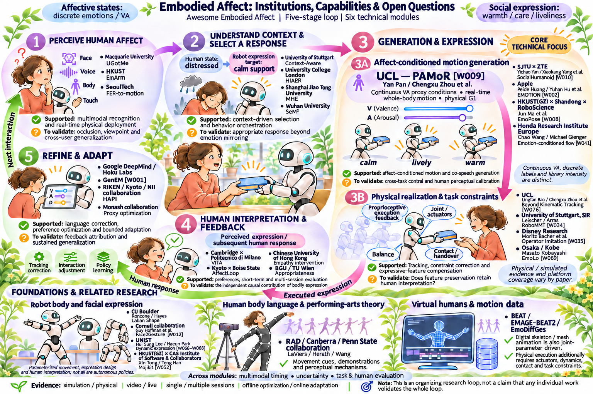
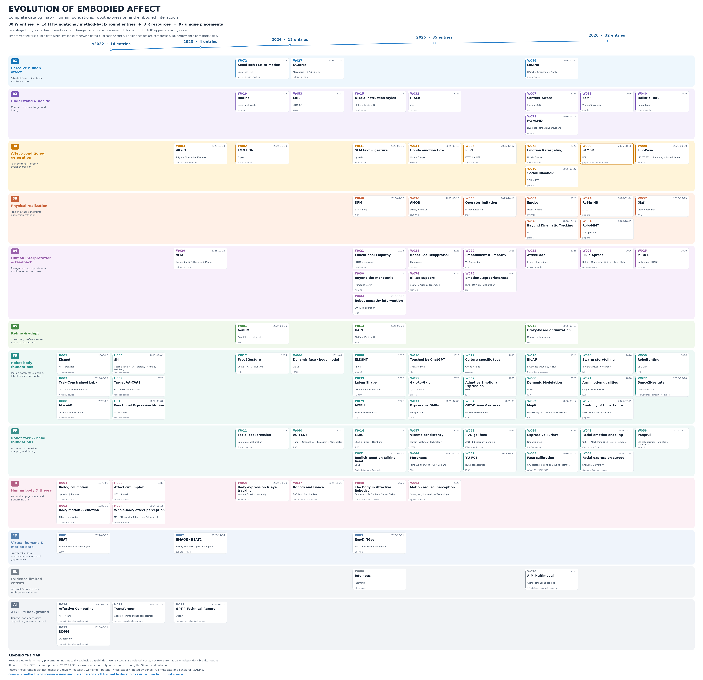

# Awesome Embodied Affect 🤖

**具身情感计算综述：感知、理解、生成与表达、反馈、适应。**

A curated survey of embodied affective computing, with a focus on affect-conditioned motion generation and physical realization in humanoid robots.

**80 项相关工作 · 五阶段闭环 · 六个技术模块 · 人体基础与数字人参考**

[研究动机](#overview) · [分类体系](#taxonomy) · [研究总览](#figures) · [方法详解](#core-methods) · [横向对比](#comparison) · [完整文献](#catalog) · [核心洞察](#insights)

### 图1：人与具身智能体的情感交互闭环

*图1．具身情感计算的交互闭环与研究框架。具身智能体感知人的情感，结合交互情境确定回应目标，生成带有目标情感的动作，并在身体与任务约束下执行；人的解读与反馈进一步影响后续行为的修正与适应。情感条件化动作生成与实体执行共同连接表达意图和实际行为，机器人表达、人体身体语言及数字人动作研究为这一过程提供理论、方法与数据支撑。*

## 📌 为什么要研究具身情感（Embodied Affect）？

同样是递出一本书，动作的速度、幅度、身体展开、朝向和停顿，可能让人感受到不同的态度。人在与机器人交互时，会同时解读**机器人做了什么、以怎样的方式做、是否注意到自己的反应**。具身情感研究关注如何把这些表达因素纳入机器人的感知、决策与运动，使任务行为与社会互动相互配合。

本综述的核心问题是：**能否把情感或社会表达转化为可调节的条件，与动作内容共同驱动实体机器人，并在执行后保留人能够理解的表达？** 这需要连接情感表示、动作生成、身体约束和人的评价。LLM／VLM提供语境理解与行为编排接口。潜变量模型、扩散模型和基于流匹配的生成模型用于合成动作；控制策略负责将参考动作落实为满足身体与任务约束的实际运动。

| 研究动机 | 需要回答的问题 | 代表入口 |
|---|---|---|
| 让动作携带可理解的表达 | 同一个任务能否表现出平静、活跃或关切？ | [MoveAE](https://msgtn.io/assets/pdf/hri20-moveae.pdf)、[Laban Shape](#w039) |
| 把表达变成可控条件 | 情感条件与动作内容如何分别调节？ | [PAMoR](#w009)、[Honda 情绪条件生成](#w041) |
| 将语境和语义落到身体 | 语言意图怎样变为当前机器人可执行的行为？ | [GenEM](#w001)、[EMOTION](#w002)、[EmoPose](#w008) |
| 在实体执行中保持表达 | 平衡、接触和任务约束介入后，表达还剩下什么？ | [Beyond Kinematic Tracking](#w076)、[RoboMMT](#w034) |
| 让人的解读参与改进 | 人是否读懂、是否喜欢，系统又怎样根据反馈调整？ | [VITA](#w020)、[HAPI](#w013) |

### 代表作导读：从情感表示到实体表达

以下工作按时间串起本综述的主要问题。选取依据是对**情感表示、可控生成、实体实现或人类验证**的代表性贡献；完整目录仍保留全部 W001–W080。日期区分首公开与正式发表。

> **1980 · 英属哥伦比亚大学 · JPSP**
>
> **[H002 · A Circumplex Model of Affect](https://pdodds.w3.uvm.edu/research/papers/others/1980/russell1980a.pdf)**  
> **James A. Russell**
>
> 以效价和唤醒度组织情感空间，为连续条件提供理论参照。机器人运动学定义的 VA 代理仍需要人的感知校准。

> **1997 · MIT Media Lab · MIT Press**
>
> **[H014 · Affective Computing](https://mitpress.mit.edu/9780262161701/affective-computing/)**  
> **Rosalind W. Picard**
>
> 从计算系统如何处理情感出发，为情感感知、建模与表达提供领域背景；本综述进一步聚焦这些能力如何与实体身体和互动结合。

> **2000 · MIT · 博士论文**
>
> **[H005 · Sociable Machines / Kismet](https://groups.csail.mit.edu/lbr/hrg/2000/phd.pdf)**  
> **Cynthia L. Breazeal**
>
> 将感知、内部状态和社会表达放入人机互动，提供理解完整交互闭环的早期系统参照。

> **2020-03 · 康奈尔大学 × 本田日本研究所 · HRI 2020**
>
> **[H008 · MoveAE](https://msgtn.io/assets/pdf/hri20-moveae.pdf)**  
> **Michael Suguitan / Randy Gomez / Guy Hoffman**
>
> 用带分类约束的变分自编码器编辑机器人情感动作，展示从预设动作走向可编辑潜空间的一条方法路线。

> **2022-03 首公开 · 加州大学伯克利分校 · IROS 2022**
>
> **[H010 · Teaching Robots to Span the Space of Functional Expressive Motion](https://arxiv.org/abs/2203.02091)**  
> **Arjun Sripathy / Andreea Bobu / Anca D. Dragan 等**
>
> 学习人的表达感知并联合考虑任务与表达目标，为“动作正确且表达可控”提供优化视角；机器人与用户研究基于仿真。

> **2024-01 首公开 · Google DeepMind × Hoku Labs · HRI 2024**
>
> **[W001 · GenEM](#w001)**  
> **Karthik Mahadevan / Leila Takayama / Dorsa Sadigh 等**
>
> 将社会意图转为机器人技能 API 的参数化代码，并通过语言反馈修订，连接语境推理、行为组合和当次纠正。

> **2024-10 首公开 · Apple · IEEE RA-L 2025**
>
> **[W002 · EMOTION](#w002)**  
> **Peide Huang / Yuhan Hu 等**
>
> 通过上下文学习生成手部运动序列，再以逆运动学与插值执行；反馈版本进一步调整自然性和可理解性。

> **2025-03 首公开 · 理化学研究所 × 京都大学 × NII · IROS 2025**
>
> **[W013 · HAPI](#w013)**  
> **Dongsheng Yang / Wataru Sato 等**
>
> 用成对人类偏好学习表情评价，再优化机器人面部参数，为“由人来校准表达”提供参考；研究对象为面部。

> **2025-08 首公开 · 本田欧洲研究所 · RO-MAN 2025**
>
> **[W041 · Autonomous Generation of Real-time Robotic Emotional Expressions](#w041)**  
> **Chao Wang / Michael Gienger / Fan Zhang**
>
> 将混合现实示范、离散情绪条件和 flow matching 连接起来，学习头、手与脸的实时表达片段。

> **2026-08 · 伦敦大学学院 UCL · 预印本**
>
> **[W009 · PAMoR](#w009)**  
> **Yan Pan / Lingfan Bao / Tianhu Peng / Chengxu Zhou**
>
> 组合动作与连续运动学 VA 先验，滚动生成机器人原生全身运动，并报告 G1 实体执行和人感知研究。它是本综述研究“情感条件与动作共同驱动”的重点入口。

> **2026-09 · 上海交通大学 × 中兴通讯 · 预印本**
>
> **[W010 · SocialHumanoid](#w010)**  
> **Chengqun Yang / Xiaokang Yang / Yichao Yan 等**
>
> 用音频和情绪条件驱动单步共语动作生成，再连接在线重定向与全身跟踪，重点处理持续表达的生成时延。

> **2026-10 · 伦敦大学学院 UCL · 预印本**
>
> **[W076 · Beyond Kinematic Tracking](#w076)**  
> **Lingfan Bao / Chengxu Zhou 等**
>
> 在全身跟踪后补偿运动幅度、能量和姿态等表达特征，将关注点延伸到“实际执行保留了什么”；人的情感意义保持仍待验证。

> **2026-10 · 斯图加特大学 SIR · 预印本**
>
> **[W034 · RoboMMT](#w034)**  
> **Till Hielscher / Kai O. Arras**
>
> 将调制表达参考、稳定跟踪与互动目标连接，研究大幅调制下的身体实现。实体迁移证据为四足，人形评估主要在仿真中。

## 🗂️ 分类体系：五阶段、六个技术模块

本综述以**实体人形机器人**为核心，比较面部、头部、机械臂、四足和桌面机器人；人体身体语言、心理与表演理论、数字人和动作数据作为理论、方法与资源支撑。

**① 感知 → ② 理解与决策 → ③A 情感条件化动作生成 → ③B 实体执行与任务约束 → ④ 人类解读与反馈 → ⑤ 修正与适应 → 下一轮交互。** 阶段③包含两个技术模块，其余四个阶段各包含一个模块。

| 技术模块 | 核心问题与输入／输出 | 代表工作 | 深入阅读 |
|---|---|---|---|
| ① 情感感知 | 从脸、语音、身体和触觉估计人的状态及不确定性 | UGotMe、EmArm、FER-to-motion | [模块解析与文献](#stage-1) |
| ② 情境理解与回应决策 | 结合任务、关系与环境，从人的状态确定机器人的回应目标 | Context-Aware、HIAER、MHE、SeM² | [模块解析与文献](#stage-2) |
| **③A 情感条件化动作生成** | 将动作内容、情感／社会意图和历史条件转为表达参考 | **PAMoR、EMOTION、SocialHumanoid、Honda flow** | [方法详解](#core-methods) · [完整条目](#stage-3a) |
| **③B 实体执行与任务约束** | 将参考运动变为满足身体、接触与任务条件的实际动作 | **Beyond Kinematic Tracking、RoboMMT、EmoLo** | [方法详解](#core-methods) · [完整条目](#stage-3b) |
| ④ 人类解读与反馈 | 测量人的感知、偏好、后续行为与多轮交互结果 | VITA、AffectLoop、Emotion Appropriateness | [模块解析与文献](#stage-4) |
| ⑤ 修正与适应 | 将纠正、偏好或后续反应转为当次调整与策略更新 | GenEM、HAPI、Proxy-based Optimization | [模块解析与文献](#stage-5) |

### 三类基础支撑

| 支撑方向 | 提供什么 | 与核心问题的连接 |
|---|---|---|
| [机器人身体与运动表达](#foundation-body)、[头部与面部表达](#foundation-face) | 可解释运动参数、形态设计、执行器映射、表达感知实验 | 为③A提供控制变量，为③B提供身体实现，为④提供评价依据 |
| [人体身体语言、心理与表演理论](#foundation-human) | 情感表示、动作线索、示范及知觉机制 | 支撑①识别、③A表达设计和④人的解读 |
| [数字人、动作表示与数据](#virtual-data) | 骨架／网格动画、情感标注、共语时序与生成模型 | 为③A提供方法和数据；迁移到实体时需处理身体、动力学与接触约束 |

### 交叉分类：读一篇论文时还要看什么？

| 分类维度 | 主要类别 | 阅读时关注 |
|---|---|---|
| 情感与表达的含义 | 狭义：离散情绪、连续 VA／VAD；广义：温暖、关切、生动、礼貌等社会表达 | 强度、唤醒度、人格和社会意图分别如何定义与测量？ |
| 身体与表达通道 | 面部／头部、机械臂、全身人形、其他机器人；身体、声音与脸的多模态组合 | 可用自由度、表达同步与跨形态迁移 |
| 生成与控制路线 | 规则／参数、库与插值、潜变量、扩散／flow、语言程序、控制／强化学习 | 情感进入了哪个环节，输出是意图、参考运动还是控制量？ |
| 证据类型 | 仿真／实体、录制／现场、单次／多次、离线优化／在线适应 | 实验对象、比较基线、人类验证和泛化范围 |

同一论文可以涉及多个模块。下文按主要研究问题安排主位置，保留交叉标签；机构与学者采用作品发表时的署名和合作信息。

## 🧭 研究总览

### 图2：人体、机器人与具身情感表达的时间演进

*图2．人体、机器人与具身情感表达的研究演进。沿时间轴与研究方向梳理情感表示、身体语言、机器人表达及具身交互的相关工作，并对照生成模型与大语言模型的发展背景，呈现从运动参数设计、学习式动作表示到情感条件生成、实体执行与反馈适应的研究脉络。各方向的论文与研究机构按时间并列呈现，展示基础研究与交互系统之间持续发展的联系。*

[SVG](assets/embodied-affect-timeline-v2-all-works.svg) · [PDF](assets/embodied-affect-timeline-v2-all-works.pdf) · [完整节点与来源](data/timeline-full-coverage-v2.json)

### 时间演进与 AI／LLM 的关系

| 时期 | 研究重心 | 对当前问题的支撑 |
|---|---|---|
| 1970s–2000s：人体与情感理论 | 生物运动知觉、情感维度、身体运动与情绪归因 | 运动线索、概念定义和人的评价 |
| 2000s–2010s：机器人表达与参数设计 | 互动调节、节奏／幅度／姿态、表演与任务约束 | 可解释表达参数和形态差异 |
| 2020–2022：学习表示与约束优化 | AE／CVAE、目标 VA、表达运动优化 | 可编辑生成、任务与表达联合优化 |
| 2023–2025：语言接口与多模态表达 | LLM程序／序列、VLM编排、情绪条件生成 | 将社会意图、场景和表达要求接入机器人行为 |
| 2026：连续条件与实体表达保持 | PAMoR、SocialHumanoid、RoboMMT与表达补偿 | 进一步连接可控生成、低延迟实现与执行后表达 |

[Transformer（2017）](https://arxiv.org/abs/1706.03762)、[DDPM（2020）](https://arxiv.org/abs/2006.11239)和[GPT-4（2023）](https://arxiv.org/abs/2303.08774)分别提供序列建模、生成建模和语言接口的方法背景。具体论文的依赖关系需逐项判断；机器人表达与人体情感研究有自身的长期积累。

历史节点：发表信息、机构与原始来源

| 编号 | 类型／研究线 | 发表与时间 | 节点 | 机构／学者 | 来源 |
|---|---|---|---|---|---|
| H001 | 理论／人体基础 | 1973 Perception & Psychophysics 14, 201–211 正式／文献日期：1973-06 | Visual perception of biological motion and a model for its analysis | Uppsala University — Gunnar Johansson | [原始来源](<https://link.springer.com/article/10.3758/BF03212378>) |
| H002 | 理论／人体基础 | 1980 Journal of Personality and Social Psychology 39(6), 1161–1178 正式／文献日期：1980 | A Circumplex Model of Affect | University of British Columbia — James A. Russell | [原始来源](<https://pdodds.w3.uvm.edu/research/papers/others/1980/russell1980a.pdf>) |
| H003 | 理论／人体基础 | 1989 Journal of Nonverbal Behavior 13, 247–268 正式／文献日期：1989-12 | The contribution of general features of body movement to the attribution of emotions | Tilburg University — Marco de Meijer | [原始来源](<https://link.springer.com/article/10.1007/BF00990296>) |
| H014 | AI方法背景 | 1997 MIT Press, hardcover ISBN 9780262161701 正式／文献日期：1997-09-24 | Affective Computing | MIT Media Lab — Rosalind W. Picard | [原始来源](<https://mitpress.mit.edu/9780262161701/affective-computing/>) |
| H005 | 机器人表达基础 | 2000 MIT Doctor of Science thesis 正式／文献日期：2000-05 | Sociable Machines: Expressive Social Exchange Between Humans and Robots | MIT — Cynthia L. Breazeal | [原始来源](<https://groups.csail.mit.edu/lbr/hrg/2000/phd.pdf>) |
| H004 | 理论／人体基础 | 2004 PNAS 101(47), 16701–16706 正式／文献日期：2004-11-23 首公开：2004-11-16 | Fear fosters flight: A mechanism for fear contagion when perceiving emotion expressed by a whole body | MGH / Harvard Medical School × Tilburg University — Beatrice de Gelder 等 | [原始来源](<https://pmc.ncbi.nlm.nih.gov/articles/PMC528902/>) |
| H006 | 机器人表达基础 | 2015 International Journal of Human-Computer Studies 正式／文献日期：2015 首公开：2015-02-04 | Emotionally expressive dynamic physical behaviors in robots | Georgia Institute of Technology × IDC Herzliya — Mason Bretan / Guy Hoffman / Gil Weinberg | [原始来源](<https://hrc2.io/assets/pdfs/papers/BretanetalIJHCS15.pdf>) |
| H011 | AI方法背景 | 2017 NeurIPS 2017 正式／文献日期：2017 首公开：2017-06-12 | Attention Is All You Need | Google Brain / Google Research / University of Toronto 作者合作 | [原始来源](<https://arxiv.org/abs/1706.03762>) |
| H007 | 机器人表达基础 | 2019 Robotics 8(2), 24 正式／文献日期：2019-03-27 | Laban-Inspired Task-Constrained Variable Motion Generation on Expressive Aerial Robots | University of Illinois at Urbana-Champaign × independent dance / Laban/Bartenieff Institute / McGuffey Art Center — Hang Cui / Catherine Maguire / Amy LaViers | [原始来源](<https://archive.the-rad-lab.org/laban-inspired-task-constrained-expressive-variable-motion-generation-on-aerial-robots>) |
| H008 | 机器人表达基础 | 2020 HRI 2020, March 23–26 正式／文献日期：2020-03 | MoveAE: Modifying Affective Robot Movements Using Classifying Variational Autoencoders | Cornell University × Honda Research Institute Japan — Michael Suguitan / Randy Gomez / Guy Hoffman | [原始来源](<https://msgtn.io/assets/pdf/hri20-moveae.pdf>) |
| H009 | 机器人表达基础 | 2020 HRI 2020 Companion / Late-Breaking Reports 正式／文献日期：2020 | Generating Robotic Emotional Body Language of Targeted Valence and Arousal with Conditional Variational Autoencoders | SFU ROSIE Lab 合作研究线 — Mina Marmpena / Fernando Garcia / Angelica Lim | [原始来源](<https://www.rosielab.ca/projects>) |
| H012 | AI方法背景 | 2020 NeurIPS 2020 正式／文献日期：2020 首公开：2020-06-19 | Denoising Diffusion Probabilistic Models | University of California, Berkeley — Jonathan Ho / Ajay Jain / Pieter Abbeel | [原始来源](<https://arxiv.org/abs/2006.11239>) |
| H010 | 机器人表达基础 | 2022 IROS 2022; UCB/EECS-2022-45 technical report 正式／文献日期：2022 首公开：2022-03-04 | Teaching Robots to Span the Space of Functional Expressive Motion | University of California, Berkeley — Arjun Sripathy / Andreea Bobu / Zhongyu Li / Koushil Sreenath / Daniel S. Brown / Anca D. Dragan | [原始来源](<https://arxiv.org/abs/2203.02091>) |
| H013 | AI方法背景 | 2023 首公开：2023-03-15 | GPT-4 Technical Report | OpenAI | [原始来源](<https://arxiv.org/abs/2303.08774>) |
| W003 | 具身表达系统 | 2023 Frontiers in Robotics and AI 12:1581110 正式／文献日期：2025-05-27 首公开：2023-12-11 | From text to motion: grounding GPT-4 in a humanoid robot “Alter3” | University of Tokyo × Alternative Machine — Takahide Yoshida / Atsushi Masumori / Takashi Ikegami | [原始来源](<https://arxiv.org/abs/2312.06571>) |
| W001 | 具身表达系统 | 2024 HRI 2024 正式／文献日期：2024-03 首公开：2024-01-26 | Generative Expressive Robot Behaviors using Large Language Models | Google DeepMind × Hoku Labs — Karthik Mahadevan / Leila Takayama 等 | [原始来源](<https://arxiv.org/abs/2401.14673>) |
| W002 | 具身表达系统 | 2024 IEEE Robotics and Automation Letters 正式／文献日期：2025 首公开：2024-10-30 | EMOTION: Expressive Motion Sequence Generation for Humanoid Robots with In-Context Learning | Apple论文作者群 — Peide Huang / Yuhan Hu 等 | [原始来源](<https://arxiv.org/abs/2410.23234>) |
| W012 | 机器人表达基础 | 2024 ACM Transactions on Human-Robot Interaction 13(3), Article 45 正式／文献日期：2024-08 | Face2Gesture: Translating Facial Expressions into Robot Movements through Shared Latent Space Neural Networks | Cornell / CMU / Plus One Robotics / Independent Researcher；部分作者实施时属Facebook AI Research | [原始来源](<https://msgtn.io/assets/pdf/thri-fg.pdf>) |
| W013 | 机器人表达基础 | 2025 IROS 2025 正式／文献日期：2025-10 首公开：2025-03-21 | HAPI: A Model for Learning Robot Facial Expressions from Human Preferences | RIKEN × Kyoto University × NII 合作 — Dongsheng Yang / Wataru Sato 等 | [原始来源](<https://arxiv.org/abs/2503.17046>) |
| W039 | 机器人表达基础 | 2025 IEEE RO-MAN 2025 正式／文献日期：2025-08 首公开：2025-05-16 | Employing Laban Shape for Generating Emotionally and Functionally Expressive Trajectories in Robotic Manipulators | University of Colorado Boulder — Srikrishna Bangalore Raghu / Bradley Hayes / Alessandro Roncone 等 | [原始来源](<https://arxiv.org/abs/2505.11716>) |
| W041 | 机器人表达基础 | 2025 IEEE RO-MAN 2025 正式／文献日期：2025 首公开：2025-08-12 | Autonomous Generation of Real-time Robotic Emotional Expressions via Human Demonstration in Mixed Reality | Honda Research Institute Europe — Chao Wang / Michael Gienger / Fan Zhang | [原始来源](<https://www.honda-ri.de/publications/publications/?pubid=6361>) |
| W009 | 具身表达系统 | 2026 首公开：2026-08-28 | PAMoR: Parameterized Affective Motion Generation in Real Time for Humanoid Robots | University College London — Yan Pan / Lingfan Bao / Tianhu Peng / Chengxu Zhou | [原始来源](<https://arxiv.org/abs/2608.28213>) |
| W010 | 具身表达系统 | 2026 首公开：2026-09-27 | SocialHumanoid: Towards Expressive Humanoid Behavior via One-Step Co-Speech Motion Generation | Shanghai Jiao Tong University × ZTE — Chengqun Yang / Xiaokang Yang / Yichao Yan 等 | [原始来源](<https://arxiv.org/abs/2609.33311>) |
| W034 | 具身表达系统 | 2026 首公开：2026-10-19 | RoboMMT: Learning Stable Tracking of Modulated Expressive and Interactive Robot Motion | University of Stuttgart SIR — Till Hielscher / Kai O. Arras | [原始来源](<https://arxiv.org/abs/2610.26414>) |
| W076 | 具身表达系统 | 2026 首公开：2026-10-14 | Beyond Kinematic Tracking: Preserving Expressive Characteristics in Humanoid Whole-Body Control | University College London 合作 — Lingfan Bao / Chengxu Zhou 等 | [原始来源](<https://arxiv.org/abs/2610.19393>) |

H编号为补充历史节点，未占用或重排已有W编号；同一工作首公开与正式出版年份的区别见[时间节点数据](data/timeline-milestones-v1.json)。

## 📊 核心方法详解：情感生成与实体执行

本节详细解析③A的九项生成工作、③B的八项执行工作，以及连接生成与反馈的三项方法。每项按研究动机、做法、贡献、结果和局限展开。

### 研究范式：做什么、以什么方式做、如何执行

目标是固定动作／任务内容，调节其表达方式，并使实际运动仍让人理解预期表达。统一接口可写为

$$
X^{\mathrm{ref}}_{t:t+H}=G_\theta(c_{\mathrm{action}},e_{\mathrm{target}},s_t,X_{<t}),\qquad
u_t=\pi_\phi(s_t,X^{\mathrm{ref}}_{t:t+H},c_{\mathrm{task}}).
$$

这是综述抽象，非任何一篇论文的原始公式。参考运动和实际控制量应分开；人的情绪估计、机器人的表达目标及观察者对结果的理解也是三个变量。

| 分析维度 | 可选内容 | 区分原则 |
|---|---|---|
| 条件表示 | 离散情绪、连续 VA、运动风格／Laban、强度、社会意图 | 强度不等于唤醒度；友好和犹豫不必硬映射为离散情绪 |
| 条件注入 | 库选择、参数调制、条件 token、FiLM、cross-attention、组合先验 | 情感可进入语义选择器、生成器或控制目标，位置不同 |
| 生成模型 | 规则／优化、库／插值、潜变量、扩散、flow／MeanFlow、LLM序列 | 潜空间可以同时用于扩散或flow；各类不是互斥路线 |
| 实体执行 | 重定向、IK、轨迹规划、全身跟踪、残差补偿、任务与接触约束 | 人体生成和机器人原生生成都可用，需同基准比较 |
| 人的验证 | 可识别性、强度可控、自然性、时机、适切性、任务效果 | 运动特征保持和人的情感意义保持须分别证明 |

数字人也以骨架／关节参数生成动作；实体机器人额外需要真实动力学、执行器、接触和任务约束。LLM生成数值关键帧、VLM选择动作库、扩散生成潜动作和RL产生控制量不能写成同一种“情感参数驱动”。

### 3A：生成与表达的九项主要工作

| ID／代表作 | 方法链 | 主要证据身份 |
|---|---|---|
| [W009 · PAMoR](https://arxiv.org/abs/2608.28213) | 连续运动学VA＋动作文本 → 可组合潜扩散 → 机器人原生运动 | 预印本；作者注明RA-L在审 |
| [W010 · SocialHumanoid](https://arxiv.org/abs/2609.33311) | 音频＋离散情绪 → RVQ潜空间MeanFlow → 重定向与全身控制 | 预印本 |
| [W041 · Honda emotion flow](https://www.honda-ri.de/publications/publications/?pubid=6361) | 离散情绪＋状态 → FiLM U-Net flow matching → 动作片段 | RO-MAN |
| [W008 · EmoPose](https://arxiv.org/abs/2609.23414) | VLM语义计划 → 库变体与强度 → 确定性轨迹 | 预印本 |
| [W002 · EMOTION](https://arxiv.org/abs/2410.23234) | 上下文学习／LLM数值序列 → IK与插值 | IEEE RA-L 2025；首次预印2024；DOI10.1109/LRA.2025.3575983 |
| [W003 · Alter3](https://www.frontiersin.org/journals/robotics-and-ai/articles/10.3389/frobt.2025.1581110/full) | 动作语义描述 → GPT-4控制程序 → 43轴执行 | Frontiers in Robotics and AI 2025；DOI10.3389/frobt.2025.1581110 |
| [W005 · PEPE](https://www.mdpi.com/2076-3417/15/23/12759) | 分层结构与情绪提示 → 离线运动代码 | Applied Sciences 15(23):12759 |
| [W031 · SLM text + gesture](https://www.frontiersin.org/journals/robotics-and-ai/articles/10.3389/frobt.2025.1581024/full) | 语言隐藏状态 → 机器人专属gesture head → 高层手势 | Frontiers in Robotics and AI |
| [W078 · Emotion Retargeting](https://www.honda-ri.de/publications/publications/?pubid=6782) | MR示范／跨部位映射 → 条件flow → 实时表达 | ICRA工作坊 |

#### W009 · PAMoR

**机构与学者：**University College London, Department of Computer Science · Yan Pan；Lingfan Bao；Tianhu Peng；Chengxu Zhou  
**发表：**arXiv（作者注明RA-L在审）；首公开：2026-08-28

- **问题：**怎样独立控制动作内容和连续表达条件？
- **方法：**机器人运动学定义VA代理，动作、V、A先验在共享潜空间逐去噪步组合，滚动生成机器人原生运动。
- **贡献：**可组合条件扩散使动作与表达分别调节。
- **成果：**论文采用29自由度G1，报告实时全身执行与独立人感知研究；运动学VA可控性与人的识别是分别评价的结果。[正文方法与实验](https://arxiv.org/html/2608.28213v2)
- **边界：**代理VA不等于心理VA；不是人的实时反馈学习，也不能把跨论文人类数字当同条件对照。

[论文／机构入口](https://arxiv.org/abs/2608.28213)。

阅读重点是动作与表达先验如何解耦、如何注入连续条件、滚动片段如何衔接。其有人的感知研究；缺口不是“无人评”，而是运动学代理与心理意义的进一步校准以及人的实时反馈学习。

#### W010 · SocialHumanoid

**机构与学者：**上海交通大学；中兴通讯 · Chengqun Yang；Tengjie Zhu；Liang Xu；Fulong Liu；Guanzhu Ren；Yitong Xing；Xuefeng Lu；Fei Shi；Siyuan Fan；Weijie Dong；Yao Mu；Xiaokang Yang；Yichao Yan  
**发表：**arXiv；首公开：2026-09-27

- **问题：**如何低延迟持续生成带情绪的共语全身动作？
- **方法：**音频、情绪与说话者条件驱动分组RVQ潜空间的改进MeanFlow单步生成，历史衔接后在线重定向并全身跟踪。
- **贡献：**结合AffectMoCap情感监督、一次前向生成和实体部署链。
- **成果：**论文报告在BEAT2同一协议下较GestureLSM约6倍推理加速；另有生成表达识别及G1持续执行实验。这是生成器推理对照，不是端到端交互或全领域统一加速比。[原文摘要与实验](https://arxiv.org/html/2609.33311v1)
- **边界：**情绪标签不是连续VA；语音轮次循环不等于人的情感反馈优化。

[论文／机构入口](https://arxiv.org/abs/2609.33311)。

#### W041 · Honda emotion flow

**机构与学者：**Honda Research Institute Europe · Chao Wang；Michael Gienger；Fan Zhang  
**发表：**IEEE RO-MAN 2025；首公开：2025-08-12

- **问题：**怎样从MR专家示范学习实时情绪表达？
- **方法：**七类情绪one-hot与机器人和目标物体状态，经FiLM条件U-Net flow matching预测头、手及脸的动作片段。
- **贡献：**示范映射与情绪条件生成相连接。
- **成果：**正式机构记录报告识别表现接近专家遥操作；早期预印本仅初步定性评估。
- **边界：**旧稿与正式记录有版本差异；非连续VA，也不据此声称实体双足全身验证。

[论文／机构入口](https://www.honda-ri.de/publications/publications/?pubid=6361)。

方法细节依据[早期预印本](https://arxiv.org/html/2508.08999v1)，正式人评结论依据机构记录；两者不可混写成同一版本的完整实验。

#### W008 · EmoPose

**机构与学者：**香港科技大学（广州）；山东大学；RoboScience · Daojie Peng；Bingtao Wang；Fulong Ma；Wenjun Yue；Liang Zhang；Jun Ma  
**发表：**arXiv；首公开：2026-09-20

- **问题：**开放语义如何可靠落到特定身体的表达手势？
- **方法：**VLM输出类别、库变体、五级强度、语音锚点；本地确定性模块生成14自由度上肢轨迹。
- **贡献：**显式划分语义选择与数值关节控制权。
- **成果：**实体G1实现29种库变体；160次完成指MuJoCo仿真试验，不是160次实体／真人交互。[项目结果](https://daojiepeng.github.io/EmoPose/)
- **边界：**不是自由连续全身生成；英语基准与固定导览场景限制外推，官方代码链接当前404。

[论文／机构入口](https://arxiv.org/abs/2609.23414)。

#### W002 · EMOTION

**机构与学者：**Apple（论文署名） · Peide Huang；Yuhan Hu；Nataliya Nechyporenko；Daehwa Kim；Walter Talbott；Jian Zhang  
**发表：**IEEE Robotics and Automation Letters, 2025；首公开：2024-10-30

- **问题：**怎样用少量示范生成自然且可理解的人形手势？
- **方法：**VLM选择手势意图，LLM上下文学习生成双手位置、朝向与手指序列，IK和插值执行；EMOTION++接受自然语言修订。
- **贡献：**从少量示范生成数值运动序列并引入反馈。
- **成果：**GR-1上部署十类手势；在线视频研究支持反馈版本的自然性和可理解性改善。
- **边界：**十手势不是十情绪；研究者先仿真修订再录制，不是长期在线个体学习。

[论文／机构入口](https://arxiv.org/abs/2410.23234)。

#### W003 · Alter3

**机构与学者：**东京大学；Alternative Machine Inc. · Takahide Yoshida；Atsushi Masumori；Takashi Ikegami  
**发表：**Frontiers in Robotics and AI 12:1581110；首公开：2023-12-11

- **问题：**语言描述怎样落到新的机器人身体上？
- **方法：**分两阶段把动作描述转为43轴Alter3的Python控制程序，允许语言调整。
- **贡献：**无需每项动作手工编码的具身语言接口。
- **成果：**展示自拍、幽灵等多种实体动作及口头修改。
- **边界：**首发2023、正式2025；不是双足全身行走策略，也不是连续VA生成。

[论文／机构入口](https://www.frontiersin.org/journals/robotics-and-ai/articles/10.3389/frobt.2025.1581110/full)。

#### W005 · PEPE

**机构与学者：**KITECH Human-Centric Robotics R&D × UST · Dong-Wook Lee；Yoongu Lim、Jaeuk Cho、Duk-Yeon Lee、Dongwoon Choi  
**发表：**Applied Sciences 15(23):12759；首公开：2025-12-02

- **问题：**仿动物机器人怎样低数据成本生成情感动作？
- **方法：**逐步提示提供猫形PEPE结构、关节角边界、代码格式及情绪原则，离线生成八类动作。
- **贡献：**将本体知识和情绪要求结构化输入代码生成过程。
- **成果：**15人现场以五点量表评分；原文总体印象均值3.0为中性，各动作评价不均，不能表述为整体高度认可。[正文第5节与结论](https://www.mdpi.com/2076-3417/15/23/12759)
- **边界：**未评在线情绪感知或长期交互；传感硬件存在不代表已纳入研究闭环。

[论文／机构入口](https://www.mdpi.com/2076-3417/15/23/12759)。

#### W031 · SLM text + gesture

**机构与学者：**乌普萨拉大学 · Alessio Galatolo；Katie Winkle  
**发表：**Frontiers in Robotics and AI 12:1581024；首公开：2025-05-16

- **问题：**小语言模型如何同时生成文本和合法高层手势？
- **方法：**从语言隐藏状态训练机器人专属gesture head，与语言头并行输出受平台词汇约束的行为。
- **贡献：**较低开销修补小模型不合法手势与参数。
- **成果：**论文报告低额外计算开销并在Furhat、Pepper上演示。
- **边界：**未做人评；输出行为意图而非精确关节轨迹，较大模型输出只是代理真值。

[论文／机构入口](https://www.frontiersin.org/journals/robotics-and-ai/articles/10.3389/frobt.2025.1581024/full)。

#### W078 · Emotion Retargeting

**机构与学者：**Honda Research Institute Europe · Chao Wang；Fan Zhang；Michael Gienger  
**发表：**IEEE ICRA 2026 Workshop Learning-HRI；首公开：2026

- **问题：**如何采集并实时复现跨部位机器人情绪行为？
- **方法：**通过MR头显采集专家第一人称遥操作，把脸、头、上身映射到眼、耳、颈和臂；flow matching按情绪与环境刺激生成。
- **贡献：**将沉浸式示范采集、身体映射和情绪条件模型连接。
- **成果：**ICRA2026 Learning-HRI工作坊机构摘要描述虚拟及实体遥操作与实时生成链。
- **边界：**与W041同线续作，不自动算独立突破；机构摘要未给足细粒度人评或双足全身任务证据。

[论文／机构入口](https://www.honda-ri.de/publications/publications/?pubid=6782)。

### 3B：实体执行与任务约束的八项主要工作

| ID／代表作 | 方法链 | 主要证据身份 |
|---|---|---|
| [W076 · Beyond Kinematic Tracking](https://arxiv.org/abs/2610.19393) | 冻结全身跟踪器 → 运动感知门控残差 → 表达特征补偿 | 预印本Under Review |
| [W034 · RoboMMT](https://arxiv.org/abs/2610.26414) | 参数化表达参考 → RL稳定跟踪 → 互动目标调制 | 预印本，2026-10 |
| [W024 · ReSIn-HR](https://arxiv.org/abs/2601.17287) | 结构化运动库＋LLM描述 → 时长感知DTW → 关节校验 | 2026预印本 |
| [W035 · Operator Imitation](https://la.disneyresearch.com/publication/autonomous-human-robot-interaction-via-operator-imitation/) | 操作者数据 → 连续命令扩散＋离散分类 → 操作接口 | IROS |
| [W036 · AMOR](https://la.disneyresearch.com/publication/amor-adaptive-character-control-through-multi-objective-reinforcement-learning/) | 奖励权重条件 → 多目标RL → 动态角色控制 | SIGGRAPH 2025；控制邻近 |
| [W037 · Olaf](https://la.disneyresearch.com/publication/olaf-bringing-an-animated-character-to-life-in-the-physical-world/) | 动画参考 → RL＋机械／噪声／温度约束 → 实体角色 | IEEE RA-L 2026，机构记录 |
| [W046 · DFM](https://sony.github.io/DFM/) | 周期潜空间／Fourier运动表示 → RL跟踪与辅助任务 | ICRA 2025 |
| [W069 · EmoLo](https://mertcookimg.github.io/emolo/) | 三类风格one-hot → 姿态／活动奖励 → 单个RL行走策略 | RO-MAN |

#### W076 · Beyond Kinematic Tracking

**机构与学者：**University College London · Lingfan Bao；Hanshang Zhu；Yan Pan；Jincheng Wang；Jingyang Yu；Tianhu Peng；Yiyang Jia；Dimitrios Kanoulas；Chengxu Zhou  
**发表：**arXiv（Under Review）；首公开：2026-10-14

- **问题：**低平均跟踪误差为何仍可能丢失表达特征？
- **方法：**冻结跟踪器上叠加门控残差，按幅度、运动能量、展开、倾斜、骨盆高度补偿；动作教师策略蒸馏为统一策略。
- **贡献：**显式优化表达特征的执行后保持，而非只优化位置误差。
- **成果：**论文在八类动作上报告仿真与G1实体实验，支持动态和姿态描述子保持改善；不表示每个描述子在每个动作上都显著改善。[原文实验](https://arxiv.org/html/2610.19393v1)
- **边界：**运动学特征不是人的情感真值；尚不能把特征恢复称为人类情感意义恢复。

[论文／机构入口](https://arxiv.org/abs/2610.19393)。

#### W034 · RoboMMT

**机构与学者：**斯图加特大学 Socially Intelligent Robotics Lab · Till Hielscher；Kai O. Arras  
**发表：**arXiv；首公开：2026-10-19

- **问题：**表达参考在高调制幅度下如何保持动态稳定？
- **方法：**在广泛表达参数域训练参考跟踪策略，再以轻量互动策略调制目标吸引点。
- **贡献：**将表达合成、稳定跟踪与空间互动目标耦合。
- **成果：**论文在四足和两个人形模型上评价；实体sim-to-real及重扰动展示为四足。不能把三种平台都写成实体人形验证。[原文摘要与实验](https://arxiv.org/html/2610.26414v1)
- **边界：**两个人形主要仿真；不能写成全部实体人形验证或连续心理VA控制。

[论文／机构入口](https://arxiv.org/abs/2610.26414)。

#### W024 · ReSIn-HR

**机构与学者：**西交利物浦大学 · Yanrong Chen；Xihan Bian  
**发表：**arXiv；首公开：2026-01-24

- **问题：**情绪语音与身体动作如何同步并可执行？
- **方法：**结构化动作库约束LLM运动描述，以时长感知DTW对齐语音与关键帧，再进行可行性校验。
- **贡献：**将多通道时序与关节约束显式连接。
- **成果：**NAO框架报告优于规则基线的情绪对齐。
- **边界：**物理可行性反馈不是人的情绪反馈；性能受任务和评价协议限制。

[论文／机构入口](https://arxiv.org/abs/2601.17287)。

#### W035 · Operator Imitation

**机构与学者：**Disney Research · Sammy Christen；David Mueller；Agon Serifi；Ruben Grandia；Georg Wiedebach；Michael Hopkins；Espen Knoop；Moritz Bächer  
**发表：**IEEE/RSJ IROS 2025；首公开：2025-10-18

- **问题：**如何从操作者社会经验学习自主角色互动？
- **方法：**统一Transformer用扩散预测连续操作命令、分类器预测离散命令，模仿不同mood交互。
- **贡献：**保留操作接口，把专家互动经验迁移到自主行为。
- **成果：**实体用户研究支持可辨mood与接近专家的简单互动，同操作接口实现另一平台迁移。
- **边界：**不是任意形态零样本迁移，也未建立人的情绪估计与连续VA闭环。

[论文／机构入口](https://la.disneyresearch.com/publication/autonomous-human-robot-interaction-via-operator-imitation/)。

#### W036 · AMOR

**机构与学者：**Disney Research；Universidade Federal do Rio Grande do Sul · Lucas N. Alegre；Agon Serifi；Ruben Grandia；David Mueller；Espen Knoop；Moritz Bächer  
**发表：**ACM SIGGRAPH 2025；首公开：2025-05-26

- **问题：**角色控制中多个冲突目标如何避免反复重训？
- **方法：**多目标RL训练由奖励权重条件化的单策略，训练后调节权衡，高层策略可再选择权重。
- **贡献：**学习一组Pareto权衡而不是固定奖励组合。
- **成果：**机构记录展示动态角色运动及新任务适应。
- **边界：**奖励权重不是情绪坐标；是物理表达控制底座，不是情绪感知或反馈论文。

[论文／机构入口](https://la.disneyresearch.com/publication/amor-adaptive-character-control-through-multi-objective-reinforcement-learning/)。

#### W037 · Olaf

**机构与学者：**Disney Research · David Mueller；Espen Knoop；Dario Mylonopoulos；Agon Serifi；Michael Hopkins；Ruben Grandia；Moritz Bächer  
**发表：**IEEE Robotics and Automation Letters, 2026；首公开：2026-05-13

- **问题：**夸张动画角色怎样在真实机械身体上保留风格？
- **方法：**动画参考引导RL，结合连杆机构、落地噪声及执行器温度约束。
- **贡献：**把角色造型、风格化控制与实体工程问题联合设计。
- **成果：**机构页报告仿真和实体Olaf实验。
- **边界：**动画风格不等于情绪参数生成；不能外推人类情绪理解或交互学习。

[论文／机构入口](https://la.disneyresearch.com/publication/olaf-bringing-an-animated-character-to-life-in-the-physical-world/)。

#### W046 · DFM

**机构与学者：**ETH Zurich RSL；Sony Group Corporation · Ryo Watanabe；Chenhao Li；Marco Hutter  
**发表：**IEEE ICRA 2025；首公开：2025-02-16

- **问题：**舞蹈跟踪如何同时允许行走和注视任务？
- **方法：**艺术参考经周期自编码器形成运动潜表示，放松过强局部周期假设，RL同时跟踪舞蹈与辅助任务。
- **贡献：**连接可插值运动表示、平滑切换和多任务实体控制。
- **成果：**作者项目展示实体执行、较FLD更细致的跟踪及频率插值。
- **边界：**expressive dance不等于离散情绪或连续VA条件；项目模板仓库不是算法代码。

[论文／机构入口](https://sony.github.io/DFM/)。

#### W069 · EmoLo

**机构与学者：**The University of Osaka；Kobe University · Masato Kobayashi  
**发表：**IEEE RO-MAN 2026:1727–1733；首公开：2026

- **问题：**低成本双足行走如何同时带有可调表达风格？
- **方法：**单个RL策略接收Happy／Neutral／Sad的one-hot，头部俯仰和活动度奖励带门控，结合sim-to-real随机化。
- **贡献：**在共享行走策略中加入少量可解释风格控制。
- **成果：**Open Duck Mini V2固定向前行走试验中展示风格区分和实体部署。
- **边界：**主要评价行走完成和头部轨迹，尚不足以证明人的情绪识别或一般交互收益；不是连续VA。

[论文／机构入口](https://mertcookimg.github.io/emolo/)。

### 连接生成、评价与修正的三项补充

| 工作 | 可借鉴的方法 | 边界 |
|---|---|---|
| [GenEM W001](https://generative-expressive-motion.github.io/) | 语言意图到技能API代码，组合与语言纠正 | 广义社会表达；不含显式连续VA |
| [HAPI W013](https://arxiv.org/html/2503.17046v2) | 成对人类偏好→RankNet→贝叶斯优化 | 35自由度面部；不能直接外推全身；代码公开部分是标注器 |
| [Proxy-based Optimization W042](https://github.com/liamreneroy/LLM_vocab_optimization) | LLM准确度代理与参数／词汇集合优化 | 功能状态表达为主；代理分数需独立人评验证 |

### 第一阶段建议如何落地

1. 建立固定动作内容的动作库／显式参数基线，验证幅度、速度、节奏和展开的独立作用。
2. 以PAMoR式连续条件与内容／表达分离为核心，对比联合条件模型和组合先验；若是共语任务，再比较音频与情绪条件的单步生成。
3. 接现有可靠实体控制栈，单独研究任务约束、表达特征损失和补偿。机器人原生表示与人体生成＋重定向需同任务、平台和延迟协议比较。
4. 校准目标表达和人的实际理解：情绪／VA识别、强度单调性、适切性、自然性、时机、任务成功。控制语音、脸部、任务完成与新奇效应的混杂。
5. 在上述关系建立后，再增加人的反馈归因、单会话修正及跨会话偏好更新。不要先假定已能从一个微笑推断应如何改变全部关节。

语音、脸、头与全身的时间协调贯穿2的回应时机、3A的表达时间线、3B的执行延迟和中断、4的人感知以及5的策略修改。关节跟踪闭环、对话轮次循环、人的情感反馈优化应分别标明。

代码资源与实验数字核验

### 代码与资料状态（2026-11-05）

| 工作 | 核验结果 |
|---|---|
| PAMoR | 本轮打开官方论文及UCL主页，未确认公开算法代码；不猜测仓库 |
| SocialHumanoid | 原文确认[项目页](https://rex0191.github.io/SocialHumanoid/)，本轮页面不可访问；官方算法代码未确认 |
| EmoPose | [官方项目页](https://daojiepeng.github.io/EmoPose/)的Code按钮指向`https://github.com/DaojiePENG/EmoPose`，本轮404；记录候选链接，不当作已可下载实现 |
| EMOTION／GenEM／Honda flow | 本轮访问的一手页未确认官方算法代码；项目、附录、演示不自动视为代码 |
| HAPI | [PairwiseExpressionAnnotator](https://github.com/KUCognitiveInformaticsLab/PairwiseExpressionAnnotator)已确认，为成对标注实验代码，非全栈 |
| Proxy-based Optimization | [作者代码与资料](https://github.com/liamreneroy/LLM_vocab_optimization)已确认，包含优化、代理验证和用户研究／统计资料；未执行复现 |
| DFM／EmoLo／Disney三项 | 一手机构／作者页已核；未确认官方可下载算法实现，不能把网站模板或引用的控制基线称为本论文代码 |

“未确认”表示截至本轮核验的证据状态，不能写成确定未开源。正式发表日期、预印本首发日期和机构页日期分别记录于结构化数据；不把预印首发或会议日期偷偷当作出版社online日期。

### 数字与证据对象复查

本轮逐项复查了正文出现的自由度、动作数、样本数和加速比。数值直接保留作者原协议的对象，不跨研究拼排名；没有取得完整统计表时不补写效应量。最容易混淆的项目已明确如下：

| 量化陈述 | 对象和来源 | 可推出的范围 |
|---|---|---|
| PAMoR 29自由度 | [PAMoR III-A](https://arxiv.org/html/2608.28213v2)中的G1运动表示 | 平台与生成对象；不是29个独立表达通道 |
| SocialHumanoid约6倍 | [SocialHumanoid摘要及实验](https://arxiv.org/html/2609.33311v1)，BEAT2同协议相对GestureLSM推理 | 指定生成器对照；不是整个机器人闭环或任意硬件加速 |
| EmoPose 29种、160次 | [作者项目](https://daojiepeng.github.io/EmoPose/)中29种实体库变体、160次MuJoCo试验 | 实体与仿真两种证据分别报告，不合并为160次实体试验 |
| EMOTION十种 | [正文III–IV](https://arxiv.org/html/2410.23234v1)的社会手势集合与GR-1录制 | 十种手势，非十种情绪，也非十项成功率 |
| Alter3 43轴 | [正式正文2.1](https://www.frontiersin.org/journals/robotics-and-ai/articles/10.3389/frobt.2025.1581110/full)的气动身体 | 机械轴数，不是动态行走控制维度 |
| PEPE 15人、3.0 | [正文第5节](https://www.mdpi.com/2076-3417/15/23/12759)，五点现场适切性评分与总体印象 | 小样本主观评价；总体中性，非普遍高识别率 |
| Beyond Tracking八类动作 | [原文实验](https://arxiv.org/html/2610.19393v1) | 运动学描述子保持，非人的情感意义保持 |
| RoboMMT两个人形 | [原文](https://arxiv.org/html/2610.26414v1)的平台评估；实体零样本迁移为四足 | 人形评估不能笼统写成实体人形部署 |
| HAPI 35自由度 | [原文](https://arxiv.org/html/2503.17046v2)的Nikola面部平台 | 面部表达，不是全身；部分情绪改善不等于全情绪普遍领先 |

## ⚖️ 横向对比：情感条件怎样进入运动系统？

比较时先统一输出层次：**表达意图 → 参考动作 → 实际控制量 → 人的解读**。下表对照方法接口与证据范围；各论文平台和评价协议不同，结果应在各自实验条件下解读。

| 路线／代表作 | 情感或表达条件 | 进入系统的位置 | 输出与身体实现 | 已有证据与主要边界 |
|---|---|---|---|---|
| 语言程序 · GenEM W001 | 社会意图、语言纠正 | LLM提示与技能API组合 | 参数化控制代码；依赖平台已有技能 | 支持组合与修订；未显式建立连续VA控制 |
| 语言数值序列 · EMOTION W002 | 手势意图、示范与语言反馈 | 上下文学习的运动序列生成 | 双手位置／朝向／手指 → IK与插值 | GR-1与录制人评；十类手势，非十类情绪 |
| 库与强度编排 · EmoPose W008 | 类别、变体、五级强度 | VLM规划与确定性库调度 | 上肢轨迹 → G1执行 | 实体库变体及独立仿真试验；库与场景范围有限 |
| 连续组合生成 · **PAMoR W009** | 动作文本＋连续运动学VA | 潜空间逐步组合动作、V、A先验 | 机器人原生参考运动 → G1全身执行 | 实体与人感知研究；运动学代理和心理VA需进一步校准 |
| 情绪条件flow · Honda W041 | 七类情绪＋机器人／目标状态 | FiLM条件U-Net flow matching | 头、手、脸的动作片段 | 示范与识别评价；正式记录与早期稿分开解读 |
| 单步共语生成 · SocialHumanoid W010 | 音频＋离散情绪＋说话者 | RVQ潜空间MeanFlow | 人体动作 → 在线重定向与全身跟踪 | G1持续执行与生成评价；标签条件，非连续VA |
| 表达稳定跟踪 · RoboMMT W034 | 参数化调制表达参考 | 跟踪策略训练域与互动吸引点 | RL跟踪与互动控制 | 实体四足、人形主要仿真；心理VA控制非其结论 |
| 执行后特征补偿 · **Beyond Tracking W076** | 参考运动及表达描述子 | 冻结跟踪器外的门控残差 | 全身控制与表达特征补偿 | G1仿真／实体特征保持；人的情感意义保持待验证 |
| 人类偏好优化 · HAPI W013 | 成对表情偏好 | RankNet评价器＋贝叶斯参数优化 | Nikola面部执行器参数 | 面部人评；迁移到全身需重新建立评价与约束 |

### 怎样选研究切入点？

| 当前问题 | 适合先比较的路线 | 建议验证 |
|---|---|---|
| 情感参数能否独立改变同一个动作？ | 可解释参数基线、PAMoR、潜变量方法 | 固定动作改条件、固定条件改动作、连续性与内容保持 |
| 需要及时的互动或共语动作？ | 库编排、Honda flow、SocialHumanoid | 端到端时延、片段衔接、时序同步、表达可理解性 |
| 生成参考已有表达，但执行变弱？ | RoboMMT、Beyond Tracking、任务约束优化 | 任务成功与稳定性、表达特征及独立人的感知评价 |
| 机器人动作可控，但人解读不一致？ | 人类感知建模、HAPI、功能表达优化 | 目标条件—实际运动—人的解读之间的校准与个体差异 |

对本综述的第一阶段，优先形成**可解释参数基线 → 情感条件化生成 → 实体执行保持 → 独立人评校准**的研究链。它是根据当前研究目标提出的组织路线，方法选择仍取决于平台、数据和任务。

## 📚 完整文献目录（80项）

第一列为图与目录中的稳定ID，第二列为理论／基础／闭环归属。各节按首公开或记录年份排序；正式发表信息单独列出，未知月份不补造。

**代码说明：**“代码未确认”表示本次未获得可确认的作者资源入口，不等于确定没有开源；项目页、局部工具与完整方法代码分别标注。

### ① 情感感知

由脸、语音、身体与触觉线索估计状态；识别触碰类别与识别人的情绪是不同任务。

- **研究动机：**回应的起点是对人的状态作出有依据的估计。

- **常见做法：**从面部、语音、身体或触碰提取线索，进行状态识别与多模态融合。

- **代表工作：**[UGotMe W027](#w027)、[EmArm W056](#w056)、[FER-to-motion W072](#w072)。

- **已有认识与缺口：**识别和局部实体部署已有研究；遮挡、视角及跨人泛化仍需分别验证。触碰类别识别、人的情绪估计和后续表达生成应分别评价。

| ID | 类型／阶段与技术模块 | 论文／作品 | 会议／期刊与时间 | 机构／主要学者 | 原文 | 代码／项目 | 核心问题、方法、贡献、结果与不足 |
|---|---|---|---|---|---|---|---|
| **W056** | 研究工作 主：1 ①感知；基础支撑 | **EmArm** Embodied sensorimotor integration for whole-arm tactile sensing and adaptive robotic manipulation | Nature Sensors 2026-07-20 已有Nature书目记录；本轮Nature认证受限，校方新闻确认题名与发表 Nature Sensors研究论文；论文日期沿用已核记录，校方2026-10-16新闻本轮可核 | HKUST Mevita Robotics Lab；Shenzhen University（合作作者）；Nankai University（合作作者） Yifeng Tang；Gen Li；Hao Ren；Tianci Yin；Zhengrong Ling；Haoxiang Zhao；Ruijia Zhang；Tieshan Zhang；Liu Yang；Yajing Shen | [原文／出版页](<https://www.nature.com/articles/s44460-026-00097-1>) | 代码未确认 未确认官方可用代码链接 [项目](<https://seng.hkust.edu.hk/news/20261016/hkust-engineering-develops-embodied-robotic-arm-emarm-human-touch-sensing>) | **问题：**全臂触觉如何支持感知与自适应操作。 **方法：**集成全臂触觉感知和感觉运动控制，包含触碰分类后表情回应演示。 **贡献：**把大面积触觉纳入具身操作接口。 **结果：**已有记录包含五类触碰到表情反馈及触碰辨识结果。 **边界：**主要贡献为触觉和操作；99.8%若引用应标触碰辨识，不能写情绪识别；本轮Nature入口认证受限。 核验：本轮定向核验官方／作者公开入口的元数据、摘要或指定段落；方法与边界结合既有阅读资料，未全面重新精读 |
| **W027** | 研究工作 主：1 ①感知；②理解决策 | **UGotMe** UGotMe: An Embodied System for Affective Human-Robot Interaction | IEEE ICRA 2025 2025 既有正式发表资料，仅年已确认；本轮未核月日 首公开：2024-10-24 2024预印本；ICRA 2025 | Macquarie University × Sun Yat-sen University × SJTU 合作 Peizhen Li、Longbing Cao、Xiao-Ming Wu、Xiaohan Yu、Runze Yang | [原文／出版页](<https://arxiv.org/abs/2410.18373>) | 代码未确认 未确认官方公开实现；null不表示确定未开源 | **问题：**噪声和多人谈话条件下怎样获取可靠情感输入？ **方法：**UGotMe处理视觉噪声、活跃说话者识别和实时多模态推理。 **贡献：**将情感识别移入实体多人互动条件。 **结果：**既有资料记录ICRA2025与实体部署。 **边界：**感知部署不是情感动作可控性或闭环效用验证。 核验：沿用已有核验资料；本轮未全文重核 |
| **W072** | 研究工作 主：1 ①感知；③A生成；基础支撑 | **SeoulTech FER-to-motion** A Robot System that Interacts with Human using Facial Expression Recognition and Motion Generation Model | Journal of Korea Robotics Society 19(4):335 2024 已有逐来源记录；本轮入口访问受限 已发表期刊论文（原文入口本轮受限） | Seoul National University of Science and Technology HCIR Ho-Joon Song；Ji-Hyeong Han | [原文／出版页](<https://doi.org/10.7746/jkros.2024.19.4.335>) | 代码未确认 未确认官方可用代码链接 | **问题：**如何将人的面部表情识别连接机器人运动回应。 **方法：**集成真实表情感知与头部跟踪，并用生成模型产生双臂动作。 **贡献：**将感知系统和动作生成模块连接进行研究。 **结果：**既有资料记录感知实体部署，双臂生成验证为仿真。 **边界：**不能写成实体双臂情感闭环；本轮DOI正文访问受限。 核验：本轮尝试出版社／原文入口但访问受限；书目、方法与边界承接已有资料，未重新阅读全文 |

### ② 情境理解与回应决策

结合对象、任务与关系确定回应目标；人的当前状态不必等于机器人的目标表达。

- **研究动机：**人的情绪并不直接决定机器人应该表达什么；回应还取决于任务、情境与互动对象。

- **常见做法：**显式状态／策略模型、行为编排、语言模型推理与多模态语境建模。

- **代表工作：**[Context-Aware W007](#w007)、[HIAER W032](#w032)、[MHE W053](#w053)、[SeM² W038](#w038)。

- **已有认识与缺口：**语境驱动的选择与编排已有实现，回应适切性、状态不确定性和跨场景泛化需要进一步评价。

| ID | 类型／阶段与技术模块 | 论文／作品 | 会议／期刊与时间 | 机构／主要学者 | 原文 | 代码／项目 | 核心问题、方法、贡献、结果与不足 |
|---|---|---|---|---|---|---|---|
| **W073** | 预印本 主：2 ②理解决策；③A生成 | **RG-VLMD** Empathetic Motion Generation for Humanoid Educational Robots via Reasoning-Guided Vision–Language–Motion Diffusion Architecture | arXiv 2026-03-19 官方／作者入口元数据；精度仅取已确认范围 arXiv预印本 | University of Liverpool（已有资料；全部作者机构映射待核） Fuze Sun；Lingyu Li；Lekan Dai；Xinyu Fan | [原文／出版页](<https://arxiv.org/abs/2603.18771>) | 代码未确认 未确认官方可用代码链接 | **问题：**教育机器人如何生成语义与教学意图一致的共语手势。 **方法：**多模态VA估计、教学推理与按教学行为和时序条件控制的扩散生成结合。 **贡献：**把情感／教学意图推理接入动作合成条件。 **结果：**预印本报告动作统计和序列可区分性改善，并描述NAO重定向接口。 **边界：**学校真人研究仍是后续方向；离线动作证据不能提升为实体真人交互闭环验证。 核验：本轮定向核验官方／作者公开入口的元数据、摘要或指定段落；方法与边界结合既有阅读资料，未全面重新精读 |
| **W040** | 研究工作 主：2 ②理解决策；③A生成；④人类反馈 | **Holistic Haru** Holistic LLM-Based Expressive Behavior Generation for Robots | ACM/IEEE HRI Companion 2026:809–813 2026 既有正式发表资料，仅年已确认；本轮未核月日 HRI Companion 2026:809–813；短论文 | Honda Research Institute Japan / Haru相关团队 Eric Nichols、Miguel Mejia Tobar、Randy Gomez | [原文／出版页](<https://doi.org/10.1145/3776734.3794507>) | 代码未确认 未确认官方公开实现；null不表示确定未开源 | **问题：**LLM如何统一组织桌面角色的多通道时间线？ **方法：**从语义规划语音、身体与表情的同步行为。 **贡献：**跨通道整体编排而非单独生成某个表情。 **结果：**既有资料记录Haru及23人先导，过度表达也可能引发负面反应。 **边界：**HRI Companion短论文；桌面角色不是全尺寸人形，需区分整体与单通道收益。 核验：沿用已有核验资料；本轮未全文重核 |
| **W038** | 预印本 主：2 ②理解决策；③A生成；③B执行 | **SeM²** Bridging Speech, Emotion, and Motion: a VLM-based Multimodal Edge-deployable Framework for Humanoid Robots | arXiv 2026 既有预印本年份；本轮未核月日 SeM²，预印本；SeM²预印本 | 武汉大学计算机学院相关机器人团队 Miao Li；Songhua Yang、Xuetao Li、Xuanye Fei、Mengde Li | [原文／出版页](<https://arxiv.org/abs/2602.07434>) | 代码未确认 未确认官方公开实现；null不表示确定未开源 | **问题：**如何在边缘机器人协调情感语音、脸和上身？ **方法：**教师与本地VLM组织语音、LED表情及上身动作。 **贡献：**面向本地部署的多模态表达接口。 **结果：**既有资料记录36自由度平台上的上身、脸与语音同步。 **边界：**平台自由度不等于全身动态情感控制，不编造实验室名或作者当前职位。 核验：沿用已有核验资料；本轮未全文重核 |
| **W007** | 研究工作 主：2 ②理解决策 | **Context-Aware** Context-Aware Generation and Modulation of Expressive Motion Behavior using Multimodal Foundation Models | ACM/IEEE HRI 2026:438–446 2026 既有正式发表资料，仅年已确认；本轮未核月日 HRI 2026:438–446；HRI 2026；DOI10.1145/3757279.3785635 | University of Stuttgart / Socially Intelligent Robotics Lab（SIR） Kai O. Arras、Till Hielscher；Andreas Bulling、Fabio Scaparro为相关论文合作者 | [原文／出版页](<https://arxiv.org/abs/2610.35615>) | [代码／资源](<https://github.com/TillHielscher/gen-mod-expressive-motion-behavior>) 已确认官方项目Code按钮链接的作者实现；含情境生成、DMP调制、时间线及Pepper／Go2／Gen3 Lite接口与示例。作者README明确蒸馏短管线模型当前未提供，不能标成全部模型和实验配置完整可复现；本轮未运行。 | **问题：**多模态情境怎样调制机器人表达？ **方法：**基础模型解析文字、音频和视频情境，组合手势并调制DMP表达参数。 **贡献：**将可解释表达基元与多模态情境连接。 **结果：**既有核验记录Pepper、Go2和Gen3 Lite展示。 **边界：**广义表达不等于狭义情绪；不同形态的实体与仿真证据须逐项区分。 核验：沿用已有核验资料；本轮未全文重核 |
| **W032** | 预印本 主：2 ②理解决策；③A生成 | **HIAER** Hierarchical Intention-Aware Expressive Motion Generation for Humanoid Robots | arXiv（具体正式会议录待核） 2025 既有预印本年份；本轮未核月日 2025预印本；页面自述IEEE conference paper，具体会议录本轮未核 | UCL Humanoid Robotics Lab Chengxu Zhou；Lingfan Bao、Yan Pan、Tianhu Peng；HIAER另有Dimitrios Kanoulas | [原文／出版页](<https://arxiv.org/abs/2506.01563>) | 代码未确认 未确认官方公开实现；null不表示确定未开源 | **问题：**如何从情境选择适当表达意图和动作？ **方法：**分层视觉语言推断社会情境、VA与意图，再选择表达动作。 **贡献：**把场景理解与行为编排分层。 **结果：**既有资料记录UCL人形表达架构及演示。 **边界：**这里VA用于意图和选择，不能等同PAMoR直接条件化生成；具体正式会议录未核。 核验：沿用已有核验资料；本轮未全文重核 |
| **W015** | 研究工作 主：2 ②理解决策；④人类反馈 | **Nikola instruction styles** Evaluating human perceptions of android robot facial expressions based on variations in instruction styles | Frontiers in Robotics and AI 2025 既有正式发表资料，仅年已确认；本轮未核月日 Frontiers in Robotics and AI；Frontiers in Robotics and AI 2025 | RIKEN Guardian Robot Project × Kyoto University × NII相关合作 Wataru Sato、Takashi Minato、Dongsheng Yang、Qianying Liu等；Nikola论文作者另见原文 | [原文／出版页](<https://www.frontiersin.org/journals/robotics-and-ai/articles/10.3389/frobt.2025.1728647/full>) | 代码未确认 未确认官方公开实现；null不表示确定未开源 | **问题：**不同自然语言指令与机器人表情评价有何关联？ **方法：**LLM依据情境从63项预设表情中选择，分析Expo现场指令与人的评价。 **贡献：**研究真实现场的指令表达和表情选择接口。 **结果：**既有资料支持大规模现场关联分析。 **边界：**非随机化因果试验；预设面部选择不是自由动作生成。 核验：沿用已有核验资料；本轮未全文重核 |
| **W053** | 研究工作 主：2 ①感知；②理解决策；③A生成；③B执行；④人类反馈 | **MHE** Multi-Modal Hierarchical Empathetic Framework for Social Robots With Affective Body Control | IEEE Transactions on Affective Computing 15(3):1621–1633 2024 官方／作者入口元数据；精度仅取已确认范围 已发表期刊论文 | Shanghai Jiao Tong University RL² Yangqing Fu；Ming Sun；Yue Gao；Feng Gao | [原文／出版页](<https://doi.org/10.1109/TAFFC.2024.3356511>) | 代码未确认 未确认官方可用代码链接 [项目](<https://gaoyue.sjtu.edu.cn/paperlist/MHE.html>) | **问题：**社会机器人如何整合情感识别、共情对话和身体回应。 **方法：**多模态融合及多任务训练，依据情感与强度控制关节位置、速度并协调语音。 **贡献：**层级结构把识别、对话与表达连接，并引入眼动分布评价。 **结果：**在真实Pepper实验中评价回应及眼动分布。 **边界：**整体系统评价不能证明身体表达的独立因果效果；不是2025新作或上海交大另一作者线。 核验：本轮定向核验官方／作者公开入口的元数据、摘要或指定段落；方法与边界结合既有阅读资料，未全面重新精读 |
| **W019** | 预印本 主：2 ②理解决策；①感知；③A生成；⑤修正适应 | **Nadine** Nadine: An LLM-driven Intelligent Social Robot with Affective Capabilities and Human-like Memory | arXiv 2024 既有预印本年份；本轮未核月日 2024预印本 | University of Geneva / MIRALab 相关合作 Nadia Magnenat-Thalmann、Hangyeol Kang 等；具体逐篇映射以原文为准 | [原文／出版页](<https://arxiv.org/abs/2405.20189>) | 代码未确认 未确认官方公开实现；null不表示确定未开源 | **问题：**如何组织具有情感与记忆的社会机器人？ **方法：**多模态输入、情感评价、情景记忆和SoR-ReAct代理统一到Nadine架构。 **贡献：**把跨回合记忆与情感选择并入系统。 **结果：**既有资料展示LLM社会机器人整体架构。 **边界：**架构整合不等于每环节已独立验证，本轮未补写人评规模和效应量。 核验：沿用已有核验资料；本轮未全文重核 |

### ③A 情感条件化动作生成

重点：条件如何进入动作生成，以及固定动作内容时能否改变表达方式。

- **研究动机：**在保持动作内容的同时调节其表达方式。

- **常见做法：**参数调制、动作库、语言程序／序列、潜变量、条件扩散与flow；情感条件可以进入选择器、生成器或优化目标。

- **代表工作：**[PAMoR W009](#w009)、[EMOTION W002](#w002)、[SocialHumanoid W010](#w010)、[Honda W041](#w041)。

- **已有认识与缺口：**多类条件生成已有机器人验证，内容与表达的独立控制、跨任务泛化及人的感知校准仍是重点。详见[方法解析](#core-methods)与[横向对比](#comparison)。

| ID | 类型／阶段与技术模块 | 论文／作品 | 会议／期刊与时间 | 机构／主要学者 | 原文 | 代码／项目 | 核心问题、方法、贡献、结果与不足 |
|---|---|---|---|---|---|---|---|
| **W010** | 预印本 主：3A ③A生成；③B执行；④人类反馈 | **SocialHumanoid** SocialHumanoid: Towards Expressive Humanoid Behavior via One-Step Co-Speech Motion Generation | arXiv 2026-09-27 arXiv预印首发 2026预印本；预印本 | 上海交通大学；中兴通讯 Chengqun Yang；Tengjie Zhu；Liang Xu；Fulong Liu；Guanzhu Ren；Yitong Xing；Xuefeng Lu；Fei Shi；Siyuan Fan；Weijie Dong；Yao Mu；Xiaokang Yang；Yichao Yan | [原文／出版页](<https://arxiv.org/abs/2609.33311>) | 代码未确认 原文确认项目页；项目页本轮不可访问，官方代码未确认 [项目](<https://rex0191.github.io/SocialHumanoid/>) | **问题：**如何低延迟持续生成带情绪的共语全身动作？ **方法：**音频、情绪与说话者条件驱动分组RVQ潜空间的改进MeanFlow单步生成，历史衔接后在线重定向并全身跟踪。 **贡献：**结合AffectMoCap情感监督、一次前向生成和实体部署链。 **结果：**论文报告同协议较GestureLSM约6倍推理加速，生成表达识别改善及G1持续执行。 **边界：**情绪标签不是连续VA；语音轮次循环不等于人的情感反馈优化。 核验：本轮复核一手正文／机构或作者资料；未复现 |
| **W008** | 预印本 主：3A ③A生成；②理解决策；③B执行 | **EmoPose** EmoPose: Vision-Language Model Guided Emotion-Aware Gesture Generation for Humanoid Robots | arXiv 2026-09-20 arXiv预印首发 2026预印本；预印本 | 香港科技大学（广州）；山东大学；RoboScience Daojie Peng；Bingtao Wang；Fulong Ma；Wenjun Yue；Liang Zhang；Jun Ma | [原文／出版页](<https://arxiv.org/abs/2609.23414>) | [作者声明链接](<https://github.com/DaojiePENG/EmoPose>) 官方项目Code按钮指向候选仓库，但本轮访问404；不作为已确认可下载代码 [项目](<https://daojiepeng.github.io/EmoPose/>) | **问题：**开放语义如何可靠落到特定身体的表达手势？ **方法：**VLM输出类别、库变体、五级强度、语音锚点；本地确定性模块生成14自由度上肢轨迹。 **贡献：**显式划分语义选择与数值关节控制权。 **结果：**实体G1实现29种库变体；项目报告160次MuJoCo试验完成及语义基准评价。 **边界：**不是自由连续全身生成；英语基准与固定导览场景限制外推，官方代码链接当前404。 核验：本轮复核一手正文／机构或作者资料；未复现 |
| **W009** | 预印本 主：3A ③A生成；③B执行；④人类反馈 | **PAMoR** PAMoR: Parameterized Affective Motion Generation in Real Time for Humanoid Robots | arXiv（作者注明RA-L在审） 2026-08-28 arXiv预印首发 预印本；页面标RA-L在审；预印本；作者注明RA-L在审 | University College London, Department of Computer Science Yan Pan；Lingfan Bao；Tianhu Peng；Chengxu Zhou | [原文／出版页](<https://arxiv.org/abs/2608.28213>) | 代码未确认 未确认官方公开实现；null不表示确定未开源 | **问题：**怎样独立控制动作内容和连续表达条件？ **方法：**机器人运动学定义VA代理，动作、V、A先验在共享潜空间逐去噪步组合，滚动生成机器人原生运动。 **贡献：**可组合条件扩散使动作与表达分别调节。 **结果：**29自由度G1实时全身执行并有人感知研究；支持目标运动学VA可控。 **边界：**代理VA不等于心理VA；不是人的实时反馈学习，也不能把跨论文人类数字当同条件对照。 核验：本轮复核一手正文／机构或作者资料；未复现 |
| **W078** | 研究工作 主：3A ③A生成；③B执行 | **Emotion Retargeting** Emotion Retargeting for Social Physical Human–Robot Interaction: Real-Time Learning of Expressive Robot Behaviors via Full-Body Human Mapping | IEEE ICRA 2026 Workshop Learning-HRI 2026 官方／作者入口元数据；精度仅取已确认范围 ICRA2026 Learning-HRI工作坊论文（Honda官方元数据） | Honda Research Institute Europe Chao Wang；Fan Zhang；Michael Gienger | [原文／出版页](<https://www.honda-ri.de/publications/publications/?pubid=6782>) | 代码未确认 未确认官方可用代码链接 [项目](<https://www.honda-ri.de/publications/publications/?pubid=6782>) | **问题：**如何收集情感身体示范并转为实时机器人表达。 **方法：**MR头显第一人称遥操作采集脸／头／上肢示范，映射到机器人部件并训练情绪条件flow matching。 **贡献：**将沉浸式采集、跨形态映射与实时生成连接。 **结果：**Honda官方摘要描述仿真／实体遥操作与响应移动物体的生成流程。 **边界：**与2025 Honda研究线要判重；本轮未核开放代码或完整人评。 核验：本轮定向核验官方／作者公开入口的元数据、摘要或指定段落；方法与边界结合既有阅读资料，未全面重新精读 |
| **W005** | 研究工作 主：3A ③A生成 | **PEPE** Design and Implementation of a Companion Robot with LLM-Based Hierarchical Emotion Motion Generation | Applied Sciences 15(23):12759 2025-12-02 出版社版本记录的原始版本 Applied Sciences 15(23):12759 | KITECH Human-Centric Robotics R&D × UST Dong-Wook Lee；Yoongu Lim、Jaeuk Cho、Duk-Yeon Lee、Dongwoon Choi | [原文／出版页](<https://www.mdpi.com/2076-3417/15/23/12759>) | 代码未确认 未确认官方公开实现；null不表示确定未开源 | **问题：**仿动物机器人怎样低数据成本生成情感动作？ **方法：**逐步提示提供猫形PEPE结构、关节角边界、代码格式及情绪原则，离线生成八类动作。 **贡献：**将本体知识和情绪要求结构化输入代码生成过程。 **结果：**15人现场评分；动作表现不均，总体平均3.0为中性，部分动作高于其他动作。 **边界：**未评在线情绪感知或长期交互；传感硬件存在不代表已纳入研究闭环。 核验：本轮复核一手正文／机构或作者资料；未复现 |
| **W041** | 研究工作 主：3A ③A生成；③B执行 | **Honda emotion flow** Autonomous Generation of Real-time Robotic Emotional Expressions via Human Demonstration in Mixed Reality | IEEE RO-MAN 2025 2025 既有正式发表资料，仅年已确认；本轮未核月日 首公开：2025-08-12 RO-MAN 2025，机构正式记录；RO-MAN | Honda Research Institute Europe Chao Wang；Michael Gienger；Fan Zhang | [原文／出版页](<https://www.honda-ri.de/publications/publications/?pubid=6361>) | 代码未确认 未确认官方公开实现；null不表示确定未开源 | **问题：**怎样从MR专家示范学习实时情绪表达？ **方法：**七类情绪one-hot与机器人和目标物体状态，经FiLM条件U-Net flow matching预测头、手及脸的动作片段。 **贡献：**示范映射与情绪条件生成相连接。 **结果：**正式机构记录报告识别表现接近专家遥操作；早期预印本仅初步定性评估。 **边界：**旧稿与正式记录有版本差异；非连续VA，也不据此声称实体双足全身验证。 核验：本轮复核一手正文／机构或作者资料；未复现 |
| **W031** | 研究工作 主：3A ③A生成；②理解决策 | **SLM text + gesture** Simultaneous text and gesture generation for social robots with small language models | Frontiers in Robotics and AI 12:1581024 2025-05-16 出版社正式发表 Frontiers in Robotics and AI | 乌普萨拉大学 Alessio Galatolo；Katie Winkle | [原文／出版页](<https://www.frontiersin.org/journals/robotics-and-ai/articles/10.3389/frobt.2025.1581024/full>) | [代码／资源](<https://www.frontiersin.org/journals/robotics-and-ai/articles/10.3389/frobt.2025.1581024/full#supplementary-material>) 出版方补充材料代码入口；原文脚注4明确说明包含方法、Furhat／Pepper部署及扩展说明代码。未下载完整核验或运行，不冒充GitHub仓库。 | **问题：**小语言模型如何同时生成文本和合法高层手势？ **方法：**从语言隐藏状态训练机器人专属gesture head，与语言头并行输出受平台词汇约束的行为。 **贡献：**较低开销修补小模型不合法手势与参数。 **结果：**论文报告低额外计算开销并在Furhat、Pepper上演示。 **边界：**未做人评；输出行为意图而非精确关节轨迹，较大模型输出只是代理真值。 核验：2026-11-05补核原文数据声明及脚注4；未运行补充代码 |
| **W002** | 研究工作 主：3A ③A生成；⑤修正适应 | **EMOTION** EMOTION: Expressive Motion Sequence Generation for Humanoid Robots with In-Context Learning | IEEE Robotics and Automation Letters, 2025 2025 既有正式发表资料，仅年已确认；本轮未核月日 首公开：2024-10-30 2024预印本；2025 RA-L；IEEE RA-L 2025；首次预印2024；DOI10.1109/LRA.2025.3575983 | Apple（论文署名） Peide Huang；Yuhan Hu；Nataliya Nechyporenko；Daehwa Kim；Walter Talbott；Jian Zhang | [原文／出版页](<https://arxiv.org/abs/2410.23234>) | 代码未确认 未确认官方公开实现；null不表示确定未开源 | **问题：**怎样用少量示范生成自然且可理解的人形手势？ **方法：**VLM选择手势意图，LLM上下文学习生成双手位置、朝向与手指序列，IK和插值执行；EMOTION++接受自然语言修订。 **贡献：**从少量示范生成数值运动序列并引入反馈。 **结果：**GR-1上部署十类手势；在线视频研究支持反馈版本的自然性和可理解性改善。 **边界：**十手势不是十情绪；研究者先仿真修订再录制，不是长期在线个体学习。 核验：本轮复核一手正文／机构或作者资料；未复现 |
| **W003** | 研究工作 主：3A ③A生成；⑤修正适应 | **Alter3** From text to motion: grounding GPT-4 in a humanoid robot “Alter3” | Frontiers in Robotics and AI 12:1581110 2025-05-27 出版社正式发表 首公开：2023-12-11 Frontiers in Robotics and AI；首版2023；Frontiers in Robotics and AI 2025；DOI10.3389/frobt.2025.1581110 | 东京大学；Alternative Machine Inc. Takahide Yoshida；Atsushi Masumori；Takashi Ikegami | [原文／出版页](<https://www.frontiersin.org/journals/robotics-and-ai/articles/10.3389/frobt.2025.1581110/full>) | 代码未确认 未确认官方公开实现；null不表示确定未开源 [项目](<https://tnoinkwms.github.io/ALTER-LLM/>) | **问题：**语言描述怎样落到新的机器人身体上？ **方法：**分两阶段把动作描述转为43轴Alter3的Python控制程序，允许语言调整。 **贡献：**无需每项动作手工编码的具身语言接口。 **结果：**展示自拍、幽灵等多种实体动作及口头修改。 **边界：**首发2023、正式2025；不是双足全身行走策略，也不是连续VA生成。 核验：本轮复核一手正文／机构或作者资料；未复现 |

### ③B 实体执行与任务约束

重点：经过重定向、跟踪和约束修正后，动作任务与可感知表达能否同时保留。

- **研究动机：**生成参考必须经过真实身体执行，平衡、接触与任务约束会改变表达。

- **常见做法：**重定向、逆运动学、轨迹约束、全身跟踪、强化学习与残差补偿。

- **代表工作：**[Beyond Kinematic Tracking W076](#w076)、[RoboMMT W034](#w034)、[EmoLo W069](#w069)。

- **已有认识与缺口：**稳定跟踪与表达特征保持均有研究；需要将运动学收益进一步连接到执行后人的理解，并区分实体与仿真平台。

| ID | 类型／阶段与技术模块 | 论文／作品 | 会议／期刊与时间 | 机构／主要学者 | 原文 | 代码／项目 | 核心问题、方法、贡献、结果与不足 |
|---|---|---|---|---|---|---|---|
| **W034** | 预印本 主：3B ③B执行；③A生成 | **RoboMMT** RoboMMT: Learning Stable Tracking of Modulated Expressive and Interactive Robot Motion | arXiv 2026-10-19 arXiv预印首发 预印本，2026-10 | 斯图加特大学 Socially Intelligent Robotics Lab Till Hielscher；Kai O. Arras | [原文／出版页](<https://arxiv.org/abs/2610.26414>) | 代码未确认 已复核RoboMMT原文及定向检索，未确认本论文官方实现；同作者animation-dmp仅基础生成器，不代表RoboMMT控制方法开源。 | **问题：**表达参考在高调制幅度下如何保持动态稳定？ **方法：**在广泛表达参数域训练参考跟踪策略，再以轻量互动策略调制目标吸引点。 **贡献：**将表达合成、稳定跟踪与空间互动目标耦合。 **结果：**四足和两个人形评价，实体四足实现抗扰动sim-to-real。 **边界：**两个人形主要仿真；不能写成全部实体人形验证或连续心理VA控制。 核验：本轮复核一手正文／机构或作者资料；未复现 |
| **W076** | 预印本 主：3B ③B执行 | **Beyond Kinematic Tracking** Beyond Kinematic Tracking: Preserving Expressive Characteristics in Humanoid Whole-Body Control | arXiv（Under Review） 2026-10-14 官方／作者入口元数据；精度仅取已确认范围 arXiv预印本，作者注明Under Review | University College London Lingfan Bao；Hanshang Zhu；Yan Pan；Jincheng Wang；Jingyang Yu；Tianhu Peng；Yiyang Jia；Dimitrios Kanoulas；Chengxu Zhou | [原文／出版页](<https://arxiv.org/abs/2610.19393>) | 代码未确认 已复核Beyond Kinematic Tracking原文及定向检索，未确认官方本论文实现；不能混淆BeyondMimic或被引用控制基线。 | **问题：**低位置误差的全身跟踪仍可能损失表达特征。 **方法：**对冻结跟踪器学习带运动感知门控的残差，以幅度、能量、展开、倾斜及骨盆高度补偿目标训练，再蒸馏统一策略。 **贡献：**直接优化表达运动特征，区别于只优化平均位置跟踪。 **结果：**G1八类动作的仿真与实机实验改善动态与姿态特征保持。 **边界：**尚未验证这些运动学补偿是否保持人的情感解读；不是新的情感条件生成器。 核验：本轮定向核验官方／作者公开入口的元数据、摘要或指定段落；方法与边界结合既有阅读资料，未全面重新精读 |
| **W037** | 研究工作 主：3B ③B执行；基础支撑 | **Olaf** Olaf: Bringing an Animated Character to Life in the Physical World | IEEE Robotics and Automation Letters, 2026 2026-05-13 机构论文页日期 IEEE RA-L 2026，机构记录 | Disney Research David Mueller；Espen Knoop；Dario Mylonopoulos；Agon Serifi；Michael Hopkins；Ruben Grandia；Moritz Bächer | [原文／出版页](<https://la.disneyresearch.com/publication/olaf-bringing-an-animated-character-to-life-in-the-physical-world/>) | 代码未确认 已复核Disney机构论文页，提供PDF及视频，未确认官方算法代码。 | **问题：**夸张动画角色怎样在真实机械身体上保留风格？ **方法：**动画参考引导RL，结合连杆机构、落地噪声及执行器温度约束。 **贡献：**把角色造型、风格化控制与实体工程问题联合设计。 **结果：**机构页报告仿真和实体Olaf实验。 **边界：**动画风格不等于情绪参数生成；不能外推人类情绪理解或交互学习。 核验：本轮复核一手正文／机构或作者资料；未复现 |
| **W024** | 预印本 主：3B ③B执行；②理解决策；③A生成 | **ReSIn-HR** Real-Time Synchronized Interaction Framework for Emotion-Aware Humanoid Robots | arXiv 2026-01-24 arXiv预印首发 2026预印本 | 西交利物浦大学 Yanrong Chen；Xihan Bian | [原文／出版页](<https://arxiv.org/abs/2601.17287>) | 代码未确认 未确认官方公开实现；null不表示确定未开源 | **问题：**情绪语音与身体动作如何同步并可执行？ **方法：**结构化动作库约束LLM运动描述，以时长感知DTW对齐语音与关键帧，再进行可行性校验。 **贡献：**将多通道时序与关节约束显式连接。 **结果：**NAO框架报告优于规则基线的情绪对齐。 **边界：**物理可行性反馈不是人的情绪反馈；性能受任务和评价协议限制。 核验：本轮复核一手正文／机构或作者资料；未复现 |
| **W069** | 研究工作 主：3B ③A生成；③B执行 | **EmoLo** EmoLo: Emotion-Inspired Expressive Locomotion via Single-Policy Reinforcement Learning on Low-Cost Bipedal Robots | IEEE RO-MAN 2026:1727–1733 2026 官方／作者入口元数据；精度仅取已确认范围 已发表IEEE RO-MAN 2026会议论文（作者项目明确卷页） | The University of Osaka；Kobe University Masato Kobayashi | [原文／出版页](<https://ieeexplore.ieee.org/document/11714983>) | 代码未确认 未确认官方可用代码链接 [项目](<https://mertcookimg.github.io/emolo/>) | **问题：**低成本双足机器人如何兼顾行走与情绪启发风格。 **方法：**单一风格条件RL策略，以头俯仰和活动量奖励调制Happy／Neutral／Sad，并做仿真到实机部署。 **贡献：**不用多套策略实现离散风格行走控制。 **结果：**官方页报告Open Duck Mini V2仿真和实体五秒前进行走，具有风格相关头部轨迹。 **边界：**没有人的情绪输入；未充分证明人能正确解读风格，头部运动差异不能替代人评。 核验：本轮定向核验官方／作者公开入口的元数据、摘要或指定段落；方法与边界结合既有阅读资料，未全面重新精读 |
| **W035** | 研究工作 主：3B ③B执行；③A生成；④人类反馈 | **Operator Imitation** Autonomous Human-Robot Interaction via Operator Imitation | IEEE/RSJ IROS 2025 2025-10-18 机构论文页日期，不等同已核出版社online日期 IROS 2025；IROS | Disney Research Sammy Christen；David Mueller；Agon Serifi；Ruben Grandia；Georg Wiedebach；Michael Hopkins；Espen Knoop；Moritz Bächer | [原文／出版页](<https://la.disneyresearch.com/publication/autonomous-human-robot-interaction-via-operator-imitation/>) | 代码未确认 已复核Disney机构论文页，提供PDF及视频，未确认官方算法代码；不将第三方复现或相邻方法作为本论文实现。 | **问题：**如何从操作者社会经验学习自主角色互动？ **方法：**统一Transformer用扩散预测连续操作命令、分类器预测离散命令，模仿不同mood交互。 **贡献：**保留操作接口，把专家互动经验迁移到自主行为。 **结果：**实体用户研究支持可辨mood与接近专家的简单互动，同操作接口实现另一平台迁移。 **边界：**不是任意形态零样本迁移，也未建立人的情绪估计与连续VA闭环。 核验：本轮复核一手正文／机构或作者资料；未复现 |
| **W036** | 研究工作 主：3B ③B执行；基础支撑 | **AMOR** AMOR: Adaptive Character Control through Multi-Objective Reinforcement Learning | ACM SIGGRAPH 2025 2025-05-26 机构论文页日期 SIGGRAPH 2025；控制邻近 | Disney Research；Universidade Federal do Rio Grande do Sul Lucas N. Alegre；Agon Serifi；Ruben Grandia；David Mueller；Espen Knoop；Moritz Bächer | [原文／出版页](<https://la.disneyresearch.com/publication/amor-adaptive-character-control-through-multi-objective-reinforcement-learning/>) | 代码未确认 已复核Disney机构论文页，提供PDF及视频，未确认官方算法代码。 | **问题：**角色控制中多个冲突目标如何避免反复重训？ **方法：**多目标RL训练由奖励权重条件化的单策略，训练后调节权衡，高层策略可再选择权重。 **贡献：**学习一组Pareto权衡而不是固定奖励组合。 **结果：**机构记录展示动态角色运动及新任务适应。 **边界：**奖励权重不是情绪坐标；是物理表达控制底座，不是情绪感知或反馈论文。 核验：本轮复核一手正文／机构或作者资料；未复现 |
| **W046** | 研究工作 主：3B 基础支撑；③B执行 | **DFM** DFM: Deep Fourier Mimic for Expressive Dance Motion Learning | IEEE ICRA 2025 2025 官方／作者入口元数据；精度仅取已确认范围 首公开：2025-02-16 ICRA 2025（官方项目与arXiv对应） | ETH Zurich RSL；Sony Group Corporation Ryo Watanabe；Chenhao Li；Marco Hutter | [原文／出版页](<https://arxiv.org/abs/2502.10980>) | 代码未确认 已复核Sony DFM官方项目和论文，项目仅Video／arXiv；页脚GitHub为网站模板，不是DFM算法代码。未确认官方算法实现，不根据网址推测sony/DFM。 [项目](<https://sony.github.io/DFM/>) | **问题：**舞蹈参考难以兼顾动作细节、平滑切换与辅助任务。 **方法：**周期自编码器学习傅里叶运动表示，结合强化学习跟踪并完成行走和朝向控制。 **贡献：**放松局部周期假设以兼顾细节、过渡和辅助任务。 **结果：**官方页面展示更准确的参考跟踪、动作过渡和实体部署。 **边界：**表达性舞蹈不等于显式情绪条件生成，也未证明人的情绪解读。 核验：本轮定向核验官方／作者公开入口的元数据、摘要或指定段落；方法与边界结合既有阅读资料，未全面重新精读 |

### ④ 人类解读与反馈

分别评价可理解性、适切性、偏好、行为与交互后果；有人评不等于反馈用于在线学习。

- **研究动机：**表达的含义取决于人的解读及互动后果。

- **常见做法：**情感／VA判断、偏好比较、适切性问卷、行为观察及跨会话研究。

- **代表工作：**[VITA W020](#w020)、[AffectLoop W022](#w022)、[Emotion Appropriateness W075](#w075)。

- **已有认识与缺口：**已有短时与纵向交互证据；语言、声音、身体表达和整体干预的贡献需要通过对照设计区分。测量人的反馈和利用反馈学习是两个研究问题。

| ID | 类型／阶段与技术模块 | 论文／作品 | 会议／期刊与时间 | 机构／主要学者 | 原文 | 代码／项目 | 核心问题、方法、贡献、结果与不足 |
|---|---|---|---|---|---|---|---|
| **W025** | 研究工作 主：4 ④人类反馈；①感知；⑤修正适应 | **MiRo-E** A Multimodal Adaptive Framework for Social Interaction with the MiRo-E Robot | Sensors 26(4):1209 2026 既有正式发表资料，仅年已确认；本轮未核月日 Sensors 26(4):1209；Sensors | Nottingham CHART Nikhil Deshpande及合作作者 | [原文／出版页](<https://pmc.ncbi.nlm.nih.gov/articles/PMC12944184/>) | 代码未确认 未确认官方公开实现；null不表示确定未开源 | **问题：**机器人如何随参与状态调整社会互动？ **方法：**MiRo-E多模态系统估计参与状态并调整语言与身体行为。 **贡献：**低成本仿动物平台的自适应交互整合。 **结果：**既有资料记录Sensors正式论文与互动评价。 **边界：**参与度不等于情绪，情绪估计未接入被评价的回路。 核验：沿用已有核验资料；本轮未全文重核 |
| **W023** | 研究工作 主：4 ④人类反馈；①感知；③A生成 | **Fluid-Xpress** Fluid-Xpress: Emotion-Aware Dual-Loop Framework for Empathic Facial Reaction in HRI | ACM/IEEE HRI Companion 2026:425–429 2026 既有正式发表资料，仅年已确认；本轮未核月日 HRI Companion 2026:425–429 | Beijing Language and Culture University / University of Manchester / Sheffield Hallam University / Pennsylvania State University 合作 Chen Kang; Madina Alitai; Yiting Wang; Ruidong Ma; Xiaochi Cai; Angelo Cangelosi; Zhegong Shangguan | [原文／出版页](<https://doi.org/10.1145/3776734.3794429>) | 代码未确认 未确认官方公开实现；null不表示确定未开源 | **问题：**怎样减少LLM等待造成的面部回应迟滞？ **方法：**快的非语言面部反馈和慢的LLM对话分成双回路。 **贡献：**把倾听时反应和语义回应分时处理。 **结果：**既有资料记录8人先导及HRI Companion短文。 **边界：**短文与小样本证据不能写成完整长期闭环验证。 核验：沿用已有核验资料；本轮未全文重核 |
| **W022** | 预印本 主：4 ④人类反馈；①感知；②理解决策；③A生成 | **AffectLoop** Closing the Affective Loop: Multimodal Speaker-Listener Emotion-Dynamics-Aware Empathetic Social Robots | APSIPA ASC 2026（作者注明接收）；arXiv 2026 既有正式发表资料，仅年已确认；本轮未核月日 预印本；作者注明APSIPA ASC 2026接收 | Kyoto University × Boise State University Zi Haur Pang; Casey Kennington; Tatsuya Kawahara | [原文／出版页](<https://arxiv.org/abs/2608.16686>) | 代码未确认 未确认官方公开实现；null不表示确定未开源 | **问题：**如何利用说话者和倾听者情绪动态形成跨回合回应？ **方法：**建模多模态情绪轨迹与机器人倾听状态，组织共情回应。 **贡献：**显式考虑双向、跨回合情感动态。 **结果：**5人先导研究与会话日志分析提供早期证据。 **边界：**小样本和事后分析不足以证明普遍稳定的闭环情绪调节。 核验：沿用已有核验资料；本轮未全文重核 |
| **W064** | 研究工作 主：4 ④人类反馈 | **Robot empathy intervention** Comparative Effectiveness of Human- and Robot-Based Interventions in Increasing Empathy Among Autistic Children | Journal of Autism and Developmental Disorders 2025-10-06 官方／作者入口元数据；精度仅取已确认范围 已发表开放获取研究论文 | The Chinese University of Hong Kong相关合作（完整署名机构见原文） Xiao-Han Li；Ming Lui；Xue-Ke Song；Yu-Ru Li；Xuan-Yu Liu；Renee Pi；Wing-Chee So | [原文／出版页](<https://link.springer.com/article/10.1007/s10803-025-07054-w>) | 代码未确认 未确认官方可用代码链接 | **问题：**机器人与人类演员的训练对儿童共情有什么作用。 **方法：**82名儿童分层随机分组，四周四次戏剧训练并进行即时和一月随访评价。 **贡献：**用受控干预比较机器人与人类教学及多个共情终点。 **结果：**论文报告两组在共情与亲社会任务表现上的改善。 **边界：**是应用干预，不是动作生成模型；相近结果不能自动称严格等效或身体表达独立效果。 核验：本轮定向核验官方／作者公开入口的元数据、摘要或指定段落；方法与边界结合既有阅读资料，未全面重新精读 |
| **W075** | 研究工作 主：4 ④人类反馈 | **Emotion Appropriateness** Exploring the Effects of Emotion Appropriateness on User Perception: A Delivery Drone Case Study | ACM/IEEE HRI 2025 2025 已有逐来源记录；本轮入口访问受限 HRI2025会议论文（既有DOI记录；本轮入口受限） | Ben-Gurion University of the Negev；TU Wien（合作网络，逐作者归属待全文补核） Viviane Herdel；Yisrael Parmet；Jessica Cauchard | [原文／出版页](<https://doi.org/10.1109/HRI61500.2025.10974116>) | 代码未确认 未确认官方可用代码链接 | **问题：**机器人表达与交互情境是否匹配会怎样影响人。 **方法：**以配送无人机进行情绪适切性条件比较和用户感知评价。 **贡献：**将表达是否适合情境作为独立研究变量。 **结果：**既有资料记录适切性对用户感知的研究。 **边界：**是用户研究而非新生成算法；不把表情越强等同回应越好；本轮DOI正文受限。 核验：本轮尝试出版社／原文入口但访问受限；书目、方法与边界承接已有资料，未重新阅读全文 |
| **W074** | 研究工作 主：4 ④人类反馈；③A生成 | **BiRDe support** Enhancing emotional support in human-robot interaction: Implementing emotion regulation mechanisms in a personal drone | Computers in Human Behavior: Artificial Humans 2025 已有逐来源记录；本轮入口访问受限 已发表期刊论文（既有DOI记录；本轮出版社重定向受限） | Ben-Gurion University of the Negev；TU Wien（合作网络，逐作者归属待全文补核） Ori Fartook；Tal Oron-Gilad；Jessica Cauchard；等（按已有资料列主要作者） | [原文／出版页](<https://doi.org/10.1016/j.chbah.2025.100146>) | 代码未确认 未确认官方可用代码链接 | **问题：**个人无人机如何在互动中提供情绪支持。 **方法：**在BiRDe平台组织情绪调节机制并评价用户体验。 **贡献：**把无人机表达纳入情绪支持交互场景。 **结果：**既有资料提供情绪支持设计与评价研究入口。 **边界：**非在线识别人的情绪；非人形动作生成；本轮出版社重定向受限，统计未重审。 核验：本轮尝试出版社／原文入口但访问受限；书目、方法与边界承接已有资料，未重新阅读全文 |
| **W030** | 研究工作 主：4 ④人类反馈 | **Beyond the monotonic** Beyond the monotonic: Enhancing human-robot interaction through affective communication | Computers in Human Behavior: Artificial Humans 3:100131 2025 既有正式发表资料，仅年已确认；本轮未核月日 Computers in Human Behavior: Artificial Humans 3:100131 | Humboldt-Universität zu Berlin; institution from HFES author abstract Kim Klüber; Linda Onnasch | [原文／出版页](<https://doi.org/10.1016/j.chbah.2025.100131>) | 代码未确认 未确认官方公开实现；null不表示确定未开源 | **问题：**情感措辞与语调是否同时改善感知与行为？ **方法：**比较情感沟通设置下的感知评价、依赖与宽恕等指标。 **贡献：**区分主观感知和实际行为终点。 **结果：**摘要支持部分感知改善，但行为指标结果并不一致。 **边界：**本轮继承摘要级证据，不能泛化为情感表达普遍提升信任或宽恕。 核验：沿用已有核验资料；本轮未全文重核 |
| **W029** | 研究工作 主：4 ④人类反馈 | **Embodiment × Empathy** Exploring the Effect of Robotic Embodiment and Empathetic Tone of LLMs on Empathy Elicitation | ICSR 2024；Springer会议录2025 2025 既有正式发表资料，仅年已确认；本轮未核月日 ICSR 2024；会议录2025 | Vrije Universiteit Amsterdam Liza Darwesh; Jaspreet Singh; Marin Marian; Eduard Alexa; Koen Hindriks; Kim Baraka | [原文／出版页](<https://arxiv.org/abs/2503.20518>) | 代码未确认 未确认官方公开实现；null不表示确定未开源 | **问题：**机器人身体与共情语气是否提高对第三方的共情？ **方法：**实验操控具身载体与LLM共情语气，比较态度和志愿帮助意愿。 **贡献：**区分身体存在与语言语气的贡献。 **结果：**60人研究中，对第三方志愿帮助意愿没有显著增益。 **边界：**非显著结果不等于证明没有任何效应；不是动作生成方法。 核验：沿用已有核验资料；本轮未全文重核 |
| **W028** | 预印本 主：4 ④人类反馈；②理解决策 | **Robot-Led Reappraisal** A Robot-Led Intervention for Emotion Regulation: From Expression to Reappraisal | arXiv（正式会刊待核） 2025 既有预印本年份；本轮未核月日 2025预印本；本次未核正式会议录 | University of Cambridge Guy Laban; Julie Wang; Hatice Gunes | [原文／出版页](<https://arxiv.org/abs/2503.18243>) | 代码未确认 未确认官方公开实现；null不表示确定未开源 | **问题：**机器人能否通过认知重评支持情绪调节？ **方法：**GPT-3.5辅助机器人引导表达与认知重评，做重复会话评价。 **贡献：**把调节目标与跨次干预纳入HRI。 **结果：**既有资料记录21名学生、5次会话。 **边界：**不能将语言干预效果归因于身体动作；本轮未核正式会议录。 核验：沿用已有核验资料；本轮未全文重核 |
| **W021** | 研究工作 主：4 ④人类反馈；②理解决策；③A生成 | **Educational Empathy** Integrating emotional intelligence, memory architecture, and gestures to achieve empathetic humanoid robot interaction in an educational setting | Frontiers in Robotics and AI 2025 既有正式发表资料，仅年已确认；本轮未核月日 Frontiers in Robotics and AI；Frontiers in Robotics and AI；DOI10.3389/frobt.2025.1635419 | 西交利物浦×利物浦大学合作 Paul Craig、Fuze Sun、Terry R. Payne等 | [原文／出版页](<https://www.frontiersin.org/journals/robotics-and-ai/articles/10.3389/frobt.2025.1635419/full>) | 代码未确认 未确认官方公开实现；null不表示确定未开源 | **问题：**情感、记忆与手势整合是否改善教育互动？ **方法：**把情感处理、记忆、语音和手势接入教育机器人并进行系统对照。 **贡献：**面向教育场景整合多种社会交互机制。 **结果：**既有资料记录Raspberry Pi机器人教学系统评价。 **边界：**整体干预不能归因于手势单一成分；西交利物浦不能写成西安交通大学。 核验：沿用已有核验资料；本轮未全文重核 |
| **W020** | 研究工作 主：4 ④人类反馈；①感知；②理解决策；⑤修正适应 | **VITA** VITA: A Multi-Modal LLM-Based System for Longitudinal, Autonomous and Adaptive Robotic Mental Well-Being Coaching | ACM Transactions on Human-Robot Interaction 14(2), Article 38 2025 既有正式发表资料，仅年已确认；本轮未核月日 首公开：2023-12-15 ACM THRI 14(2),Article 38；首版2023 | University of Cambridge × Politecnico di Milano 合作 Micol Spitale、Minja Axelsson、Hatice Gunes | [原文／出版页](<https://doi.org/10.1145/3712265>) | 代码未确认 未确认官方公开实现；null不表示确定未开源 | **问题：**机器人如何跨周适应用户的心理健康辅导互动？ **方法：**VITA使用多模态LLM、面部效价和说话时长等线索组织自主及自适应辅导。 **贡献：**把情感线索和纵向部署连接。 **结果：**既有资料记录17人、4周真实职场研究。 **边界：**整套辅导效果不等于肢体表达的独立因果贡献；首版和正式版不重复计数。 核验：沿用已有核验资料；本轮未全文重核 |

### ⑤ 修正、偏好与适应

区分当次纠正、离线优化、跨回合个体化和持续学习。

- **研究动机：**不同的人和场景可能需要不同表达，系统应能根据纠正和偏好调整。

- **常见做法：**语言修订、代理评价、成对偏好建模和参数优化。

- **代表工作：**[GenEM W001](#w001)、[HAPI W013](#w013)、[Proxy-based Optimization W042](#w042)。

- **已有认识与缺口：**当次修订和有界离线优化已有方法；跨回合个体化、长期适应与反馈归因需要更充分验证。

| ID | 类型／阶段与技术模块 | 论文／作品 | 会议／期刊与时间 | 机构／主要学者 | 原文 | 代码／项目 | 核心问题、方法、贡献、结果与不足 |
|---|---|---|---|---|---|---|---|
| **W042** | 研究工作 主：5 ⑤修正适应；③A生成；④人类反馈 | **Proxy-based optimization** LLM-Driven Expressive Robot Motion Via Proxy-Based Optimization | IEEE Robotics and Automation Letters 11(4):4561–4568 2026-02-19 作者代码仓库自述发表日期，未重核IEEE元数据 IEEE RA-L 11(4):4561–4568 | Monash Robotics / Dana Kulić相关合作 Dana Kulić、Liam Roy、Elizabeth A. Croft、Alex Ramirez | [原文／出版页](<https://doi.org/10.1109/LRA.2026.3666351>) | [代码／资源](<https://github.com/liamreneroy/LLM_vocab_optimization>) 已确认作者公开优化、代理验证与统计资料；未执行复现 | **问题：**如何优化一组容易区分的机器人功能状态动作？ **方法：**用LLM预测辨识准确度作为代理，结合运动参数和词汇集合的爬山优化。 **贡献：**以代理评价降低反复人评搜索成本并优化整个表达词汇。 **结果：**作者仓库公开优化、代理验证、统计与用户研究资料。 **边界：**主要是功能状态；代理分数不是人类真值，未核全文时不补写效应量或跨平台结论。 核验：本轮复核一手正文／机构或作者资料；未复现 |
| **W013** | 研究工作 主：5 ⑤修正适应；③A生成；④人类反馈 | **HAPI** HAPI: A Model for Learning Robot Facial Expressions from Human Preferences | IEEE/RSJ IROS 2025（作者注明接收） 2025 既有正式发表资料，仅年已确认；本轮未核月日 首公开：2025-03-21 IROS 2025接收，见作者页面说明；IROS 2025（作者注明接收） | RIKEN Guardian Robot Project × Kyoto University × NII相关合作 Dongsheng Yang；Qianying Liu；Wataru Sato；Takashi Minato；Chaoran Liu；Shin'ya Nishida | [原文／出版页](<https://arxiv.org/abs/2503.17046>) | [代码／资源](<https://github.com/KUCognitiveInformaticsLab/PairwiseExpressionAnnotator>) 已确认作者提供成对表情标注实验代码；非完整HAPI训练／控制栈 | **问题：**机器人面部优化怎样对齐人的偏好？ **方法：**收集成对比较，Siamese RankNet学习偏好，再用贝叶斯优化寻找面部参数。 **贡献：**以人的相对判断替代仅依赖人脸分类器分数。 **结果：**35自由度Nikola面部上，部分情绪的真实感与表达评价优于基线和专家设计。 **边界：**脸部不是全身；公开库为成对标注器，不代表完整训练与控制栈开源。 核验：本轮复核一手正文／机构或作者资料；未复现 |
| **W001** | 研究工作 主：5 ⑤修正适应；②理解决策；③A生成 | **GenEM** Generative Expressive Robot Behaviors using Large Language Models | ACM/IEEE HRI 2024 2024 既有正式发表资料，仅年已确认；本轮未核月日 首公开：2024-01-26 HRI 2024；HRI | Google DeepMind；Hoku Labs Karthik Mahadevan；Jonathan Chien；Noah Brown；Zhuo Xu；Carolina Parada；Fei Xia；Andy Zeng；Leila Takayama；Dorsa Sadigh | [原文／出版页](<https://arxiv.org/abs/2401.14673>) | 代码未确认 未确认官方公开实现；null不表示确定未开源 [项目](<https://generative-expressive-motion.github.io/>) | **问题：**怎样从社会意图产生可组合且可修改的机器人表达？ **方法：**LLM少样本提示把语言转为可用机器人技能API的参数化代码，并利用语言反馈修订。 **贡献：**连接情境推理、技能组合与用户纠正。 **结果：**用户研究与仿真支持表达行为的可理解性和能力感知。 **边界：**没有显式连续VA；参数化控制代码不等于通用全身情感策略。 核验：本轮复核一手正文／机构或作者资料；未复现 |

### 基础支撑：机器人身体与运动表达

动作参数、表现设计和人类解读为情境化具身表达提供能力基础；这不是价值或成熟度的低层排名。

| ID | 类型／阶段与技术模块 | 论文／作品 | 会议／期刊与时间 | 机构／主要学者 | 原文 | 代码／项目 | 核心问题、方法、贡献、结果与不足 |
|---|---|---|---|---|---|---|---|
| **W070** | 预印本 主：基础·身体 基础支撑；③A生成；④人类反馈 | **Anatomy of Uncertainty** Anatomy of Uncertainty: Expressive Descriptors of Robot Motion for Nonverbal Human-Robot Communication | arXiv 2026-07-15 官方／作者入口元数据；精度仅取已确认范围 arXiv预印本；v2为2026-09-23 | Nanyang Technological University（已有资料；全部作者机构映射待核） Ridhima Bector；Souravik Dutta；Poornima Ramachandran；Ree Yan Yeoh；Jui Hien Tan；Domenico Campolo；Bernhard Johannes Schmitt | [原文／出版页](<https://arxiv.org/abs/2607.13696>) | 代码未确认 原文链接为视频与问卷材料，匿名材料入口；未确认实现代码 [项目](<https://anonymous.4open.science/r/aou/>) | **问题：**机器人如何通过运动非言语地表达感知不确定性。 **方法：**承诺—警觉状态空间结合Laban因素，五种运动原语和11个运动学描述符。 **贡献：**用参数化任务进度与目标方位变化构造可解释表达。 **结果：**视频人评中目标状态的众数识别超过机会，且描述符改变影响感知强度。 **边界：**表达的是机器人不确定性而非人的情绪；主要正式人评为视频，不能替代实体交互验证。 核验：本轮定向核验官方／作者公开入口的元数据、摘要或指定段落；方法与边界结合既有阅读资料，未全面重新精读 |
| **W052** | 研究工作 主：基础·身体 基础支撑；③A生成；④人类反馈 | **MojiKit** From Pets to Robots: MojiKit as a Data-Informed Toolkit for Affective HRI Design | ACM CHI 2026 2026 原文会议与DOI元数据 首公开：2026-03-12 已发表CHI 2026会议论文 | HKUST (Guangzhou)；HKUST；Institute of Software, Chinese Academy of Sciences；Tsinghua University；Beijing Institute of Technology；Sichuan University Liwen He；Pingting Chen；Ziheng Tang；Yixiao Liu；Jihong Jeung；Teng Han；Xin Tong | [原文／出版页](<https://doi.org/10.1145/3772318.3790830>) | [代码／资源](<https://github.com/ARKxLab/MojiKit>) 原文脚注直接链接；仓库含PC与ESP32版本实现，未运行；未在本轮核定完整许可证 [项目](<https://github.com/ARKxLab/MojiKit>) | **问题：**拟兽机器人情感行为设计过度依赖个人直觉。 **方法：**整合人宠视频分析、设计参考卡、MomoBot原型与无代码控制工具。 **贡献：**把情感意图、触发、原语与人的解释转成可共创工具。 **结果：**18人工作坊共创35种交互模式；官方动作序列设计器仓库可访问。 **边界：**35种模式并非全部已实体实现；设计工具不等于自主情境到动作策略。 核验：本轮定向核验官方／作者公开入口的元数据、摘要或指定段落；方法与边界结合既有阅读资料，未全面重新精读 |
| **W077** | 数据集／工作坊 主：基础·身体 基础支撑 | **Dance2Hesitate** Dance2Hesitate: A Multi-Modal Dataset of Dancer-Taught Hesitancy for Understandable Robot Motion | ACM/IEEE HRI 2026 D-TUR Workshop（数据集论文） 2026 官方／作者入口元数据；精度仅取已确认范围 首公开：2026-03-10 HRI2026 D-TUR Workshop录用的数据集论文；非HRI主会全文 | University of Colorado Boulder；Pacific Lutheran University（已有资料，逐作者归属见原文） Srikrishna Bangalore Raghu；Anna Soukhovei；Divya Sai Sindhuja Vankineni；Alexandra Bacula；Alessandro Roncone | [原文／出版页](<https://arxiv.org/abs/2603.10166>) | 代码未确认 已确认数据集项目入口；未将数据链接冒充算法实现代码 [项目](<https://brsrikrishna.github.io/Dance2Hesitate/>) | **问题：**可理解的犹豫动作需要跨机器人和人的示教数据。 **方法：**采集Franka Panda动觉示教与舞者RGB-D上肢／全身动作，分级标注犹豫程度。 **贡献：**提供特定情境和形态配对的多模态舞者示教数据。 **结果：**原稿列70条全身、84条上肢、66条机器人动觉轨迹，并链接公开数据项目。 **边界：**数据集不等于已训练生成策略；形态和积木接近情境限制泛化。 核验：本轮定向核验官方／作者公开入口的元数据、摘要或指定段落；方法与边界结合既有阅读资料，未全面重新精读 |
| **W071** | 研究工作 主：基础·身体 基础支撑 | **Arm motion qualities** Can We Automatically Label Expressive Robot Arm Motion Qualities? Open Dataset and Machine Learning Results | IEEE Robotics and Automation Letters 2026 已有逐来源记录；本轮入口访问受限 RA-L论文（既有DOI记录；本轮出版社入口受限） | Oregon State University SHARE Nnamdi Nwagwu；Damien Pearl；Naomi T. Fitter | [原文／出版页](<https://doi.org/10.1109/LRA.2026.3663820>) | 代码未确认 未确认官方可用代码链接 | **问题：**能否自动标注机械臂表达性质并降低手工设计负担。 **方法：**收集Laban动作质感示范数据并比较特征与序列分类方法。 **贡献：**提供公开数据／标签学习的研究入口。 **结果：**既有资料记录动作质感分类实验；本轮DOI入口受限，未确认官方数据仓库。 **边界：**分类不是生成；论文题名的open dataset声明不等于已核到可下载官方链接。 核验：本轮尝试出版社／原文入口但访问受限；书目、方法与边界承接已有资料，未重新阅读全文 |
| **W068** | 研究工作 主：基础·身体 基础支撑；③A生成；④人类反馈 | **Dynamic Modulation** Dynamic Modulation of Emotional Expressions in Social Robots: Effects on Liveliness and Naturalness | IEEE ICRA 2026 2026 既有DOI记录＋UNIST官方原稿 ICRA2026会议论文（既有DOI与UNIST官方原稿记录） | UNIST Haeun Park；Sun Jun Hwang；Hyojin Kim；Jiyeon Lee；Hui Sung Lee | [原文／出版页](<https://doi.org/10.1109/ICRA57385.2026.11695991>) | 代码未确认 未确认官方可用代码链接 | **问题：**动态情绪调制是否改善机器人的生动感与自然度。 **方法：**二阶情感动力学中调节阻尼比和过冲，构造每种情绪五级动态强度，并开展人的评价。 **贡献：**在同一情绪内以明确动力学参数控制表达夸张程度。 **结果：**官方原稿摘要称惊讶的生动感随强度增加，其他情绪常在中等强度更自然。 **边界：**效果依情绪与用户而变；离线人评不等于在线反馈学习，本轮未重审全部统计。 核验：本轮定向核验官方／作者公开入口的元数据、摘要或指定段落；方法与边界结合既有阅读资料，未全面重新精读 |
| **W050** | 研究工作 主：基础·身体 基础支撑；③A生成；④人类反馈 | **RoboBunting** RoboBunting: Building Social, Affective Expressiveness through Bilateral Force Exchange | ACM Transactions on Human–Robot Interaction 2026 官方／作者入口元数据；精度仅取已确认范围 ACM THRI论文（UBC官方项目列2026；本轮未核卷期／正式发布日期） | University of British Columbia SPIN Bereket Guta；Karon E. MacLean | [原文／出版页](<https://doi.org/10.1145/3807949>) | 代码未确认 未确认官方可用代码链接 [项目](<https://www.cs.ubc.ca/labs/spin/node/604>) | **问题：**触觉身体回应如何传达社会特征与生动感。 **方法：**用毛绒接触装置进行双向力交换，调节刚度、速度、时序和主从角色。 **贡献：**将表达变量扩展到接触力与双向动力学。 **结果：**官方项目与既有记录支持不同触觉参数影响社会印象的研究。 **边界：**不是视觉全身情绪生成；不能把治疗潜力写成已验证临床效果。 核验：本轮定向核验官方／作者公开入口的元数据、摘要或指定段落；方法与边界结合既有阅读资料，未全面重新精读 |
| **W045** | 研究工作 主：基础·身体 基础支撑；③A生成 | **Swarm storytelling** From Text to Movement: LLM-driven Swarm User Interfaces for Embodied and Interactive Storytelling | ACM IUI 2026: 1085–1099 2026 已有逐来源记录；本轮入口访问受限 已发表会议论文（既有DOI记录，本轮ACM入口403） | Tsinghua MiLab；Neurobo Ruhan Wang；Shuowen Li；Peiran Zhang；Danqi Huang；Yijie Guo；Haipeng Mi | [原文／出版页](<https://doi.org/10.1145/3742413.3789128>) | 代码未确认 未确认官方可用代码链接 | **问题：**如何将叙事情境转为低自由度实体群体的表达动作。 **方法：**将情感运动原语与LLM故事编排结合，控制Toio平面移动群体。 **贡献：**以物理移动原语为语言叙事提供具身输出接口。 **结果：**既有阅读记录包含18个情感运动原语的轨迹评价。 **边界：**非人形四肢／全身；本轮出版社入口403，方法总结承接已有资料。 核验：本轮尝试出版社／原文入口但访问受限；书目、方法与边界承接已有资料，未重新阅读全文 |
| **W018** | 研究工作 主：基础·身体 基础支撑；③A生成；①感知；②理解决策 | **BioAI²** Biomimetic hairy affective-touch sensory AI interface | Nature Communications 17:4146 2026 既有正式发表资料，仅年已确认；本轮未核月日 Nature Communications 17:4146；Nature Communications；DOI10.1038/s41467-026-70334-1 | 东南大学×NUS合作 吴俊、石琼峰、Chengkuo Lee；Jianlong Hong等 | [原文／出版页](<https://www.nature.com/articles/s41467-026-70334-1>) | 代码未确认 未确认官方公开实现；null不表示确定未开源 | **问题：**如何从类毛发触觉感受情感相关接触线索？ **方法：**仿生触觉接口与AI识别抚摸等输入，接ChatGPT选择机器狗预定义反馈。 **贡献：**连接新型触觉感知与社会反馈接口。 **结果：**既有资料记录13人感知数据采集及Bittle反馈展示。 **边界：**13人采集不是长期闭环效用试验；反馈不是全身运动生成学习。 核验：沿用已有核验资料；本轮未全文重核 |
| **W004** | 研究工作 主：基础·身体 基础支撑；③A生成 | **GPT-Driven Gestures** GPT-Driven Gestures: Leveraging Large Language Models to Generate Expressive Robot Motion for Enhanced Human-Robot Interaction | IEEE Robotics and Automation Letters 10(5):4172–4179 2025-05 Monash官方出版记录的Published - May 2025 IEEE RA-L 10(5):4172–4179 | Monash Robotics / Dana Kulić相关合作 Dana Kulić、Liam Roy、Elizabeth A. Croft、Alex Ramirez | [原文／出版页](<https://doi.org/10.1109/LRA.2025.3547631>) | [代码／资源](<https://github.com/liamreneroy/LLM_motion>) 已核作者公开仓库，含LLM提示与查询、生成运动及两项人评数据和统计；README链接本论文IEEE记录，未运行复现。 | **问题：**非人形机器人怎样通过运动表达功能状态？ **方法：**LLM选择四足Go1的表达运动参数，与人工和随机参数比较。 **贡献：**利用LLM先验构造可辨识的身体状态词汇。 **结果：**既有资料记录实体Go1与人类辨识评价。 **边界：**功能状态与情绪须分开；本轮未阅读全文，不补写效应量或所有作者现职。 核验：既有内容摘要；2026-11-05补核机构出版记录与作者代码入口，未复现 |
| **W033** | 研究工作 主：基础·身体 基础支撑；③A生成；③B执行 | **Expressive DMPs** Interactive Expressive Motion Generation Using Dynamic Movement Primitives | IEEE/RSJ IROS 2025 2025 既有正式发表资料，仅年已确认；本轮未核月日 首公开：2025-04-09 IROS 2025 | University of Stuttgart / Socially Intelligent Robotics Lab（SIR） Till Hielscher；Andreas Bulling；Kai O. Arras | [原文／出版页](<https://arxiv.org/abs/2504.06735>) | [代码／资源](<https://github.com/TillHielscher/animation-dmp>) 已确认Context-Aware官方项目Code (DMP Basis [IROS25])按钮链接的作者IROS2025实现；包含animation_dmp库、多种调制参数与示例。为DMP表达生成方法代码，不冒充RoboMMT的RL跟踪或全套机器人部署栈；本轮未运行。 | **问题：**动画原则怎样成为可调节的机器人运动模型？ **方法：**用弹簧阻尼结构的DMP参数化动画原则强度，学习、组合与在线调整表达基元。 **贡献：**把广义表达原则转换为可解释运动参数。 **结果：**论文摘要记录三种运动学平台、实体／仿真及用户研究。 **边界：**动画生动性不等于特定情绪可识别，也不自动解决双足动态稳定。 核验：本轮复核一手正文／机构或作者资料；未复现 |
| **W079** | 研究工作 主：基础·身体 基础支撑；③A生成；④人类反馈 | **MOFU** 接触に応じて膨張・収縮動作を行うロボットのふるまいに対する印象評価 | 日本机器人学会 RSJ 2025 官方／作者入口元数据；精度仅取已确认范围 RSJ2025会议成果（Sony官方记录） | Sony Corporation；外部合作作者（官网以星号标注） 茂木泰生；齋藤真里；仲田佳弘 | [原文／出版页](<https://www.sony.com/ja/SonyInfo/technology/publications/impression-evaluation-of-robot-behavior-that-expands-and-contracts-in-response-to-touch/>) | 代码未确认 未确认官方可用代码链接 | **问题：**触碰后体积膨胀／收缩会怎样改变人的机器人印象。 **方法：**MOFU执行触碰触发的膨胀、收缩或暂停，20名参与者组内比较。 **贡献：**把全身体积形变作为触觉回应表达通道。 **结果：**官方摘要的焦虑分量表条件差异不显著，p=.64；不应改写为已降低焦虑。 **边界：**触觉触发不等于人的情绪估计；排序趋势与总体条件显著差异分开解读。 核验：本轮定向核验官方／作者公开入口的元数据、摘要或指定段落；方法与边界结合既有阅读资料，未全面重新精读 |
| **W067** | 研究工作 主：基础·身体 基础支撑；③A生成 | **Adaptive Emotional Expression** Adaptive Emotional Expression in Social Robots: A Multimodal Approach to Dynamic Emotion Modeling | IEEE ICRA 2025:5504–5511 2025 UNIST官方原稿参考文献；不将会议举办月强当发表月 ICRA2025会议论文；官方UNIST后续论文参考表确认页码 | UNIST Haeun Park；Jiyeon Lee；Hui Sung Lee | [原文／出版页](<https://doi.org/10.1109/ICRA55743.2025.11127502>) | 代码未确认 未确认官方可用代码链接 | **问题：**社会机器人如何对多模态刺激动态更新情感表达。 **方法：**采用动态情感建模并组织多模态刺激到面部／身体输出。 **贡献：**将动态内部状态和多模态表达控制连接。 **结果：**已有阅读记录和UNIST正式论文参考表确认该工作及页码。 **边界：**触摸刺激不是人的心理情绪真值；本轮未重新获取该篇全文，细节不外推。 核验：本轮定向核验官方／作者公开入口的元数据、摘要或指定段落；方法与边界结合既有阅读资料，未全面重新精读 |
| **W055** | 研究工作 主：基础·身体 基础支撑；①感知；②理解决策；③A生成 | **Gait-to-Gait** Gait-to-Gait Emotional Human–Robot Interaction Utilizing Trajectories-Aware and Skeleton-Graph-Aware Spatial–Temporal Transformer | Sensors 25(3):734 2025 已有逐来源记录；本轮入口访问受限 已发表期刊论文（本轮MDPI限流） | Xi’an Jiaotong-Liverpool University；University of the Sunshine Coast Chenghao Li；Kah Phooi Seng；Li-Minn Ang | [原文／出版页](<https://www.mdpi.com/1424-8220/25/3/734>) | 代码未确认 未确认官方可用代码链接 | **问题：**如何依据人的步态情绪组织机器人的步态回应。 **方法：**轨迹感知与骨架图感知时空Transformer识别，再让NAO执行预设情感步态。 **贡献：**结合人的步态线索与机器人回应映射。 **结果：**既有资料报告NAO的识别到回应流程。 **边界：**预设步态回应不等于自由生成策略；Chenghao Li署XJTLU，其余作者机构分别记录；本轮原站限流。 核验：本轮尝试出版社／原文入口但访问受限；书目、方法与边界承接已有资料，未重新阅读全文 |
| **W039** | 研究工作 主：基础·身体 基础支撑；③A生成；④人类反馈 | **Laban Shape** Employing Laban Shape for Generating Emotionally and Functionally Expressive Trajectories in Robotic Manipulators | IEEE RO-MAN 2025（作者注明接收） 2025 既有正式发表资料，仅年已确认；本轮未核月日 RO-MAN 2025（作者注明接收）；RO-MAN | University of Colorado Boulder / HIRO及Bradley Hayes合作团队 Alessandro Roncone、Bradley Hayes、Srikrishna Bangalore Raghu、Clare Lohrmann等 | [原文／出版页](<https://arxiv.org/abs/2505.11716>) | 代码未确认 未确认官方公开实现；null不表示确定未开源 [项目](<https://brsrikrishna.github.io/ROMAN_25/>) | **问题：**机械臂能否同时表达情绪和犹豫等功能状态？ **方法：**用Laban Effort和Shape构造、调制Panda轨迹并做人感知评价。 **贡献：**结合形状与力度理论的参数化表达。 **结果：**既有资料记录49份有效在线视频评价。 **边界：**VAD由自由情绪词映射而非直接连续评分；无人的当前情绪输入，犹豫不等于离散情绪。 核验：沿用已有核验资料；本轮未全文重核 |
| **W017** | 预印本 主：基础·身体 基础支撑；③A生成 | **Culture-specific touch** Exploring LLM-generated Culture-specific Affective Human-Robot Tactile Interaction | arXiv 2025 既有预印本年份；本轮未核月日 2025预印本；预印本 | Ghent University / imec相关HRI团队 Tony Belpaeme、Qiaoqiao Ren；Giulio Antonio Abbo、Ruben Janssens、Seppe Van de Vreken | [原文／出版页](<https://arxiv.org/abs/2507.22905>) | 代码未确认 未确认官方公开实现；null不表示确定未开源 | **问题：**LLM生成的触摸表达是否具有文化适切性？ **方法：**比较不同文化条件的触摸描述、情感解码和适切性评价。 **贡献：**把文化条件纳入社会表达研究。 **结果：**既有资料记录90人对文本描述的评价。 **边界：**不是90人的实体机器人触摸实验；文本意图和身体触觉执行不可等同。 核验：沿用已有核验资料；本轮未全文重核 |
| **W016** | 研究工作 主：基础·身体 基础支撑；③A生成 | **Touched by ChatGPT** Touched by ChatGPT: Using an LLM to Drive Affective Tactile Interaction | ACM/IEEE HRI 2025 2025 既有正式发表资料，仅年已确认；本轮未核月日 HRI 2025 | Ghent University / imec相关HRI团队 Tony Belpaeme、Qiaoqiao Ren；Giulio Antonio Abbo、Ruben Janssens、Seppe Van de Vreken | [原文／出版页](<https://arxiv.org/abs/2501.07224>) | 代码未确认 未确认官方公开实现；null不表示确定未开源 | **问题：**LLM能否通过触觉模式表达情绪和触摸手势？ **方法：**由语言模型设计振动模式，在物理触觉装置上播放并做人评。 **贡献：**扩展表达通道至触觉。 **结果：**既有资料记录32人评价情感触觉模式。 **边界：**触觉袖套不是机器人灵巧手，也不证明完整身体接触策略。 核验：沿用已有核验资料；本轮未全文重核 |
| **W006** | 预印本 主：基础·身体 基础支撑；③A生成；③B执行 | **ELEGNT** ELEGNT: Expressive and Functional Movement Design for Non-anthropomorphic Robot | arXiv／Apple公开研究稿（正式会刊待核） 2025 既有预印本年份；本轮未核月日 2025论文；此表链接预印本；Apple研究公开稿/预印本；不依据模板判断录用 | Apple 表达机器人研究作者群 Yuhan Hu、Peide Huang、Jian Zhang、Mouli Sivapurapu；EMOTION另有Nataliya Nechyporenko、Daehwa Kim、Walter Talbott | [原文／出版页](<https://arxiv.org/abs/2501.12493>) | 代码未确认 未确认官方公开实现；null不表示确定未开源 | **问题：**功能任务和生动社会表达如何共同影响非人形动作设计？ **方法：**在灯具机器人上比较功能导向与加入表达目标的动作设计。 **贡献：**展示以运动承载意图与社会特性的设计空间。 **结果：**既有资料记录灯具平台及任务情境中的表达设计与用户评价。 **边界：**不是LLM动作生成；不是连续情绪参数或人形全身控制。 核验：沿用已有核验资料；本轮未全文重核 |
| **W066** | 研究工作 主：基础·身体 基础支撑；③A生成 | **Dynamic face / body model** Developing a Dynamic Expression Model That Can Simultaneously Control Robot's Facial and Movement Expressions | Journal of Institute of Control, Robotics and Systems 30(1):8–12 2024-01 UNIST Issued Date 已发表期刊论文 | UNIST Haeun Park；Jiyeon Lee；Byounghern Kim；Temirlan Dzhoroev；Hui Sung Lee | [原文／出版页](<https://doi.org/10.5302/J.ICROS.2024.23.0133>) | 代码未确认 未确认官方可用代码链接 | **问题：**固定情绪动作序列无法自然处理表达途中出现的新刺激。 **方法：**线性动态情感表达模型将刺激转为六类情绪和脸／身体控制点。 **贡献：**在表达过程中连续更新内部状态，支持平滑情绪过渡。 **结果：**UNIST记录报告12个面部控制点、3个运动控制点及动态适应演示。 **边界：**刺激驱动内部状态不等于推断人的真实心理情绪；本轮核机构元数据／摘要，未重新精读。 核验：本轮定向核验官方／作者公开入口的元数据、摘要或指定段落；方法与边界结合既有阅读资料，未全面重新精读 |
| **W012** | 研究工作 主：基础·身体 基础支撑；③A生成；①感知 | **Face2Gesture** Face2Gesture: Translating Facial Expressions into Robot Movements through Shared Latent Space Neural Networks | ACM Transactions on Human-Robot Interaction 13(3), Article 45 2024 既有正式发表资料，仅年已确认；本轮未核月日 ACM THRI 13(3),Article 45；THRI | Cornell/CMU/Plus One等 Michael Suguitan; Nick DePalma; Guy Hoffman; Jessica Hodgins | [原文／出版页](<https://doi.org/10.1145/3623386>) | 代码未确认 未确认官方公开实现；null不表示确定未开源 | **问题：**缺少丰富面部的机器人如何把人的表情转成身体动作？ **方法：**共享潜空间神经网络连接人脸表情与机器人运动。 **贡献：**通过跨模态潜表示迁移情感表达线索。 **结果：**既有资料记录开心、悲伤映射及愤怒混淆等人感知现象。 **边界：**匹配人的情绪不自动等于适切回应；不是连续全身任务条件生成。 核验：沿用已有核验资料；本轮未全文重核 |

### 基础支撑：机器人头部与面部

包括肌肉／执行器映射、共表达、时序同步与标定；与全身身体生成分别比较。

| ID | 类型／阶段与技术模块 | 论文／作品 | 会议／期刊与时间 | 机构／主要学者 | 原文 | 代码／项目 | 核心问题、方法、贡献、结果与不足 |
|---|---|---|---|---|---|---|---|
| **W062** | 综述／理论 主：基础·头脸 基础支撑 | **Facial expression survey** 人形机器人面部情感表达技术研究综述 | 计算机科学 53(7):1–8 2026-07-15 期刊出版日期 首公开：2026-07-10 已发表综述 | Shanghai University 柯显信；李玄；宋骏骐 | [原文／出版页](<https://www.jsjkx.com/CN/10.11896/jsjkx.250600166>) | 代码未确认 未确认官方可用代码链接 | **问题：**人形机器人面部情感表达技术如何分类与演进。 **方法：**回顾机械结构、仿生皮肤、情感建模和多模态时空对齐。 **贡献：**按基础表达、交互增强和个性化共鸣组织技术脉络。 **结果：**形成面部表达技术综述与研究方向。 **边界：**综述不是2026新机器人系统验证；历史样机与当前论文贡献应区分。 核验：本轮定向核验官方／作者公开入口的元数据、摘要或指定段落；方法与边界结合既有阅读资料，未全面重新精读 |
| **W065** | 专利 主：基础·头脸 基础支撑；③B执行 | **Face calibration** 一种人形机器人面部表情映射与标定方法／A method for facial expression mapping and calibration of humanoid robots | 中国专利 CN121661700A 2026-03-13 Google Patents所载A版公开日 专利A版公开；另有B版2026-06-02公开记录，不作权利法律判断 | TAICANG INSTITUTE OF COMPUTING TECHNOLOGY CHINESE ACADEMY OF SCIENCES（专利申请人） 钱晓涛；康峻玮；朱登明；冯兵；朱正刚 | [原文／出版页](<https://patents.google.com/patent/CN121661700A/en>) | 代码未确认 未确认官方可用代码链接 | **问题：**怎样把面部表情表示映射到实体舵机并标定。 **方法：**专利描述MLP／LSTM映射与视觉校准流程。 **贡献：**把blendshape到舵机的工程映射与校准连接。 **结果：**公开专利A版，另有2026-06-02的B版记录。 **边界：**专利非同行评议效果验证；申请人是太仓相关机构而非自动等同中科院计算所本部；不作权利状态法律判断。 核验：本轮定向核验官方／作者公开入口的元数据、摘要或指定段落；方法与边界结合既有阅读资料，未全面重新精读 |
| **W058** | 预印本 主：基础·头脸 基础支撑；③A生成；③B执行 | **Pengrui** Morphology-Independent Facial Expression Imitation for Human-Face Robots | arXiv 2026-03-07 官方／作者入口元数据；精度仅取已确认范围 arXiv预印本；代码仅将发布声明 | Beijing Institute of Technology相关合作（已有资料；首面全机构待核） Xu Chen；Rui Gao；Che Sun；Zhehang Liu；Yuwei Wu；Shuo Yang；Yunde Jia | [原文／出版页](<https://arxiv.org/abs/2603.07068>) | 代码未确认 原稿称will be released；未确认官方可用代码链接 | **问题：**人脸形态差异会干扰机器人表情模仿。 **方法：**自监督解耦表情与形态表示，再以表达误差学习映射到执行器。 **贡献：**用形态独立的表情语义连接人脸和实体Pengrui。 **结果：**预印本摘要报告实体机器人多种表情重现。 **边界：**仅面部；代码为将发布声明，未确认仓库；本轮未补全首面所有机构归属。 核验：本轮定向核验官方／作者公开入口的元数据、摘要或指定段落；方法与边界结合既有阅读资料，未全面重新精读 |
| **W043** | 研究工作 主：基础·头脸 基础支撑；③A生成；③B执行 | **Facial emotion enabling** Toward Enabling Facial Emotional Expressions in Humanoid Robots | Concurrency and Computation: Practice and Experience 38(3): e70554 2026-02-02 Wiley正式发表记录 已发表研究论文（出版社Version of Record） | University of Shanghai for Science and Technology；Mech-Mind Robotics；CETC 32nd Research Institute；University of Hamburg Yongtong Zhu；Lei Li；Ji Hong；Weiye Liu；Qingdu Li；Ge Gao；Youshuang Ding；Jialang He；Na Liu；Jianwei Zhang；Ye Yuan | [原文／出版页](<https://doi.org/10.1002/cpe.70554>) | 代码未确认 未确认官方可用代码链接 | **问题：**预编程面部表达费工且泛化受限。 **方法：**采用仿生执行面部、自动采集动作原语数据与KAN加注意力的学习框架。 **贡献：**将实体面部自监督表达学习与自动采集流程结合。 **结果：**出版社摘要报告跨被试多样面部模仿；本轮不重述未独立核对的量化收益。 **边界：**面部与头部研究，不等于全身表达；不能把同团队其他论文作者套入本篇。 核验：本轮定向核验官方／作者公开入口的元数据、摘要或指定段落；方法与边界结合既有阅读资料，未全面重新精读 |
| **W049** | 研究工作 主：基础·头脸 基础支撑；③A生成；④人类反馈 | **Expressive Furhat** Expressive Furhat: Generating Real-Time Facial Expressions for Human-Robot Dialogue with LLMs | ACM/IEEE HRI Companion 2026: 456–460 2026 官方／作者入口元数据；精度仅取已确认范围 已发表会议伴随论文（HRI Companion，非主会全文混标） | Ghent University；imec Giulio Antonio Abbo；Ruben Janssens；Seppe Van de Vreken；Tony Belpaeme | [原文／出版页](<https://doi.org/10.1145/3776734.3794436>) | [代码／资源](<https://github.com/giubots/expressive-furhat>) 作者Zenodo软件记录与论文机构页相互对应；GitHub仓库可访问，未运行 [项目](<https://zenodo.org/records/18269231>) | **问题：**如何实时生成适合对话情境的Furhat面部行为。 **方法：**用LLM驱动模块化面部手势生成、渲染与视线回避，并衔接Furhat API。 **贡献：**将实时面部表达拆为可扩展模块与Python库。 **结果：**机构摘要报告较基线更好的用户感知、情感回应与自然度。 **边界：**头脸而非全身；本轮核机构元数据与摘要，未重审全文及统计；代码声明与可用仓库分开。 核验：本轮定向核验官方／作者公开入口的元数据、摘要或指定段落；方法与边界结合既有阅读资料，未全面重新精读 |
| **W059** | 研究工作 主：基础·头脸 基础支撑；③A生成；③B执行 | **YU-F01** A Soft-Skin Facial Robot Capable of Real-Time Emotion-Driven Actuation Through Visual Perception | ICIRA 2025 / LNCS 16075:54–66 2025-10-27 官方／作者入口元数据；精度仅取已确认范围 已发表会议论文／书章；ICIRA2025，书卷版权2026 | Huazhong University of Science and Technology相关合作 Xuanhe Fan；Huijuan Zhao；Shuangjiang He；Li Li；Li Yu | [原文／出版页](<https://link.springer.com/chapter/10.1007/978-981-95-2098-5_5>) | 代码未确认 未确认官方可用代码链接 | **问题：**低成本软皮脸如何实时模仿不同人的表情。 **方法：**关键点分层映射与16舵机轮询同步控制，实现12个AU。 **贡献：**结合低成本软皮结构、身份适应映射与低资源执行。 **结果：**出版社摘要报告表情模仿PCC 89.7%及资源占用改善。 **边界：**PCC不是人的情绪识别率；首次在线2025，卷版权2026；付费全文未重审。 核验：本轮定向核验官方／作者公开入口的元数据、摘要或指定段落；方法与边界结合既有阅读资料，未全面重新精读 |
| **W044** | 会议论文（作者注明RSS录用） 主：基础·头脸 基础支撑；③A生成；③B执行 | **Morpheus** Morpheus: A Neural-Driven Animatronic Face with Hybrid Actuation and Diverse Emotion Control | RSS 2025（作者项目与预印本标注） 2025 官方／作者入口元数据；精度仅取已确认范围 首公开：2025-07-22 预印本注明RSS 2025录用；同题期刊DOI线索本轮未核，不重复计数 | Tsinghua AIR；BAAI；Tsinghua IIIS；MGI Tech；Beihang University Zongzheng Zhang；Jiawen Yang；Ziqiao Peng；Meng Yang；Jianzhu Ma；Lin Cheng；Huazhe Xu；Hang Zhao；Hao Zhao | [原文／出版页](<https://arxiv.org/abs/2507.16645>) | [代码／资源](<https://github.com/ZZongzheng0918/Morpheus-Software>) 官方项目直接链接；仓库可访问且含实现文件与运行说明，未运行复现 [项目](<https://jiawenyang-ch.github.io/Morpheus-Hardware-Design/>) | **问题：**仿生面部中刚性机构精度与绳驱结构紧凑性难以兼得。 **方法：**混合刚性与绳驱执行；自模型学习电机到面部关键点映射，再学习语音到blendshape控制。 **贡献：**结合硬件混合执行和可学习面部自模型。 **结果：**展示真实面部及语音条件多种情绪表达，并提供官方软硬件仓库。 **边界：**限面部；另有同题期刊记录线索，本轮未核正式期刊版本；RSS程序链接当前404，不据此否认作者录用声明。 核验：本轮定向核验官方／作者公开入口的元数据、摘要或指定段落；方法与边界结合既有阅读资料，未全面重新精读 |
| **W051** | 研究工作 主：基础·头脸 基础支撑；③A生成；③B执行 | **Implicit-emotion talking head** 隐式情绪导向的语音驱动仿生机器人说话方法 | 计算机应用研究 42(8): 2297–2303 2025-08-05 期刊印刷出版历史 首公开：2025-04-01 已发表期刊论文 | 上海理工大学机器智能研究院 徐康；袁野；付军秀；傅柯婷；任钦泽；刘娜 | [原文／出版页](<https://www.arocmag.cn/abs/2025.01.0011>) | 代码未确认 未确认官方可用代码链接 | **问题：**如何从语音隐含情绪生成自然面部和头部运动。 **方法：**特征融合自编码器从音频推断情绪特征，并加入颈部舵机控制系数。 **贡献：**不依赖显式情绪参数，联合面部与颈部运动输出。 **结果：**期刊摘要报告多数据集表现改善及轻量化实现。 **边界：**本轮核元数据和摘要；不是连续VA可编辑的全身生成方法，详细人评未重审。 核验：本轮定向核验官方／作者公开入口的元数据、摘要或指定段落；方法与边界结合既有阅读资料，未全面重新精读 |
| **W061** | 报告／正式书目待核 主：基础·头脸 基础支撑；③B执行 | **PVC-gel face** Design and prototyping of a lightweight humanoid facial robot using modular multilayered PVC gel actuators | ICRAIC 2025（教师官方报告／题名记录） 2025 教师官方发表／报告目录 2025会议报告／题名机构记录；正式论文集书目尚待补核 | Zhejiang University of Technology Yi Li；Mingfei Guo；Yanbiao Li；等（本条报告作者待正式书目补全） | [原文／出版页](<https://homepage.zjut.edu.cn/liyi/>) | 代码未确认 未确认官方可用代码链接 [项目](<https://homepage.zjut.edu.cn/liyi/>) | **问题：**轻量面部机器人如何使用柔性人工肌肉驱动。 **方法：**模块化多层PVC凝胶执行器及轻量面部结构设计与原型。 **贡献：**以柔性执行器探索面部硬件形态。 **结果：**官方教师目录记录2025报告；另有2024期刊实体原型基础。 **边界：**2025记录正式论文全文和书目未完整核；不把2024期刊自动替换成本条或称情感生成策略。 核验：本轮定向核验官方／作者公开入口的元数据、摘要或指定段落；方法与边界结合既有阅读资料，未全面重新精读 |
| **W057** | 研究工作 主：基础·头脸 基础支撑；③A生成；③B执行 | **Viseme consistency** A Viseme-Based Approach to Emotion-Consistent Facial Expression Generation in Humanoid Head Robots: Synchronizing Lip Shape, Speech, and Emotional Expression | IEEE ICCRE 2025:223–228 2025 已有逐来源记录；本轮入口访问受限 ICCRE 2025会议论文；DOI入口本轮受限 | Harbin Institute of Technology（已有作者目录） Linqianhao Liu；Weiguo Wu；等（完整作者表待核） | [原文／出版页](<https://doi.org/10.1109/ICCRE65455.2025.11093539>) | 代码未确认 未确认官方可用代码链接 | **问题：**头部机器人如何保持唇形、语音与情绪表达一致。 **方法：**以viseme表征组织唇形与面部情绪同步。 **贡献：**把唇形和情绪一致性作为头脸生成约束。 **结果：**既有作者目录与DOI记录确认该同步研究。 **边界：**全文与人评细节本轮未核；不能将头脸同步泛化为全身表达能力。 核验：本轮尝试出版社／原文入口但访问受限；书目、方法与边界承接已有资料，未重新阅读全文 |
| **W014** | 研究工作 主：基础·头脸 基础支撑；③A生成；①感知；③B执行 | **FABG** FABG: End-to-end Imitation Learning for Embodied Affective Human-Robot Interaction | IEEE/RSJ IROS 2025 2025 既有正式发表资料，仅年已确认；本轮未核月日 2025预印本；IROS 2025；DOI10.1109/IROS60139.2025.11246538；IROS 2025 | 上海理工大学机器智能研究院 × 卓益得Droid Robot × 汉堡大学 Qingdu Li（李清都）、Jianwei Zhang（张建伟）、Ye Yuan（袁野）；Yanghai Zhang、Changyi Liu、Wenbin Zhou、Keting Fu等 | [原文／出版页](<https://arxiv.org/abs/2503.01363>) | 代码未确认 未确认官方公开实现；null不表示确定未开源 | **问题：**如何学习情感面部与头眼回应并补偿延迟？ **方法：**VR示范结合DINOv2视觉表征与ACT模仿学习，生成面部、注视和相关行为。 **贡献：**将示范、视觉理解和时延处理连接到实体表情平台。 **结果：**既有正式目录核验为IROS2025，25自由度脸／头眼平台。 **边界：**25自由度不是全身；不应把同一合作网络作者混为每篇完整作者表。 核验：沿用已有核验资料；本轮未全文重核 |
| **W060** | 研究工作 主：基础·头脸 基础支撑；③A生成；③B执行 | **AU-FEDS** Unlocking Human-Like Facial Expressions in Humanoid Robots: A Novel Approach for Action Unit Driven Facial Expression Disentangled Synthesis | IEEE Transactions on Robotics 2024 官方／作者入口元数据；精度仅取已确认范围 已发表T-RO研究论文（河海大学2024官方记录） | Hohai University；Changzhou University；University of Leicester；University of Manchester Rongrong Ni；Biao Yang；Siyang Song；Angelo Cangelosi；Xiaofeng Liu | [原文／出版页](<https://ieeexplore.ieee.org/document/10582526>) | 代码未确认 未确认官方可用代码链接 [项目](<https://ai.hhu.edu.cn/2024/0707/c15658a285898/page.htm>) | **问题：**机器人面部如何生成可编辑且连续变化的细致表情。 **方法：**AU驱动解耦生成，再以映射网络转为机器人运动指令。 **贡献：**AU组合与强度提供可控的细粒度表情接口。 **结果：**河海官方记录展示离散表情、连续过渡和实体脸执行。 **边界：**面部而非全身；2025转载新闻不是新论文；数字人REACT工作不能当本篇实体执行证据。 核验：本轮定向核验官方／作者公开入口的元数据、摘要或指定段落；方法与边界结合既有阅读资料，未全面重新精读 |
| **W011** | 研究工作 主：基础·头脸 基础支撑；③A生成；①感知；④人类反馈 | **Facial coexpression** Human-robot facial coexpression | Science Robotics 9:eadi4724 2024 既有正式发表资料，仅年已确认；本轮未核月日 Science Robotics 9:eadi4724 | Columbia Creative Machines Lab 相关合作 Hod Lipson 及原论文合作者（非完整作者名单） | [原文／出版页](<https://doi.org/10.1126/scirobotics.adi4724>) | 代码未确认 未确认官方公开实现；null不表示确定未开源 | **问题：**机器人如何及时而非滞后地回应人的微笑？ **方法：**预测人即将出现的表情，结合机器人面部自模型进行共同表情生成。 **贡献：**将预测时机和身体自映射纳入面部回应。 **结果：**既有资料记录人的微笑预测与机器人同步表情回应。 **边界：**面部同步不等于身体任务生成；不能外推完整同理心或全身能力。 核验：沿用已有核验资料；本轮未全文重核 |

### 理论与邻近基础：人体身体语言

人体运动、表演与感知机制支持生成设计和评价；人体识别结果不能直接当成机器人表达有效性。

| ID | 类型／阶段与技术模块 | 论文／作品 | 会议／期刊与时间 | 机构／主要学者 | 原文 | 代码／项目 | 核心问题、方法、贡献、结果与不足 |
|---|---|---|---|---|---|---|---|
| **W063** | 研究工作 主：理论／人体 基础支撑；④人类反馈 | **Motion arousal perception** How Do Humans Recognize the Motion Arousal of Non-Humanoid Robots? | Applied Sciences 15(4):1887 2025 已有逐来源记录；本轮入口访问受限 已发表期刊论文（本轮MDPI限流） | Guangdong University of Technology（论文署名） Zihao Chen；Qisi Xie；Dingbang Luh | [原文／出版页](<https://www.mdpi.com/2076-3417/15/4/1887>) | 代码未确认 未确认官方可用代码链接 | **问题：**人如何从非人形运动判断唤醒程度。 **方法：**控制幅度和整体运动特征，使用仿真视频进行人的感知评价。 **贡献：**隔离可解释运动参数与感知唤醒度的联系。 **结果：**既有记录支持不同运动特征影响唤醒度解读。 **边界：**仿真视频不是真机全身生成；论文署名机构与作者当前任职分别记录；本轮原站限流。 核验：本轮尝试出版社／原文入口但访问受限；书目、方法与边界承接已有资料，未重新阅读全文 |
| **W048** | 综述／理论 主：理论／人体 基础支撑；①感知；③A生成；④人类反馈 | **The Body in Affective Robotics** The Body in Affective Robotics: A Survey and Conceptual Positioning Using the Performing Arts as a Scaffold for Understanding Bodily Expressed Emotion | IEEE Transactions on Affective Computing（在线2025；既有卷期记录17(2):1218–1236） 2026 既有正式卷期记录；本轮机构页仍按2025 Early Access列页1–20 首公开：2025 已发表综述；2025在线发表已核，2026卷期承接已有记录 | University of Canberra；RAD Lab；Pennsylvania State University；Stelarc（独立表演艺术家） Damith Herath；Amy LaViers；Sitao Zhang；Nipuni Hansika Wijesinghe；Sharni Konrad；Stelarc；Janie Busby Grant；James Z. Wang | [原文／出版页](<https://doi.org/10.1109/TAFFC.2025.3598454>) | 代码未确认 未确认官方可用代码链接 | **问题：**身体动作怎样表达情感，以及表演艺术能提供哪些概念。 **方法：**综述身体情感识别与生成，并借表演艺术进行概念定位。 **贡献：**强调情境、交互意图和身体表达的多样性。 **结果：**提供身体情感机器人研究的问题框架与未来方向。 **边界：**不是新运动生成系统；本轮机构页确认2025在线，2026卷期沿用已有记录。 核验：本轮定向核验官方／作者公开入口的元数据、摘要或指定段落；方法与边界结合既有阅读资料，未全面重新精读 |
| **W047** | 综述／理论 主：理论／人体 基础支撑 | **Robots and Dance** Robots and Dance: A Promising Young Alchemy | Annual Review of Control, Robotics, and Autonomous Systems 8: 323–350 2025-05 出版社卷期出版月 首公开：2024-11-26 已发表综述 | The Robotics, Automation, and Dance (RAD) Lab Amy LaViers | [原文／出版页](<https://doi.org/10.1146/annurev-control-060923-100542>) | 代码未确认 未确认官方可用代码链接 | **问题：**舞蹈如何对机器人学提供可系统研究的贡献。 **方法：**综述舞蹈与机器人在执行器、感知、动作描述及实验范式上的交叉。 **贡献：**提出身体动作符号系统与可重复人机交互环境两项挑战。 **结果：**形成choreobotics的研究梳理与问题框架。 **边界：**综述而非新生成系统；本篇正式页仅列Amy LaViers，不能套用W048合作作者。 核验：本轮定向核验官方／作者公开入口的元数据、摘要或指定段落；方法与边界结合既有阅读资料，未全面重新精读 |
| **W054** | 研究工作 主：理论／人体 基础支撑；④人类反馈 | **Body expression & eye tracking** Human Perception of the Emotional Expressions of Humanoid Robot Body Movements: Evidence from Survey and Eye-Tracking Measurements | Biomimetics 9(11):684 2024-11-08 已有逐来源记录；本轮入口访问受限 已发表期刊论文（本轮原入口验证码受限） | Nanjing Forestry University Wa Gao；Shiyi Shen；Yang Ji；Yuan Tian | [原文／出版页](<https://pmc.ncbi.nlm.nih.gov/articles/PMC11591740/>) | 代码未确认 未确认官方可用代码链接 | **问题：**人如何解读人形机器人不同身体情绪表达。 **方法：**用Yanshee六类身体表达进行问卷与眼动测量。 **贡献：**将主观解读与视觉注意指标结合。 **结果：**既有资料提供身体表达的人类感知证据。 **边界：**是感知评价而非生成模型；本轮PMC入口验证码，结果细节沿用已有阅读记录。 核验：本轮尝试出版社／原文入口但访问受限；书目、方法与边界承接已有资料，未重新阅读全文 |

### 证据受限的工程与概念条目

保留摘要、工程与企业线索的可追踪性，不与完整方法论文视为同等级实证。

| ID | 类型／阶段与技术模块 | 论文／作品 | 会议／期刊与时间 | 机构／主要学者 | 原文 | 代码／项目 | 核心问题、方法、贡献、结果与不足 |
|---|---|---|---|---|---|---|---|
| **W026** | 会议摘要／署名待核 主：证据受限 candidate | **AIM Multimodal** A Multimodal Emotional Interaction Framework Driven by Large Language Models | IEEE/ASME AIM 2026（摘要记录） 2026 既有正式发表资料，仅年已确认；本轮未核月日 IEEE/ASME AIM 2026 | 待原始署名核验 待原始署名核验 | [原文／出版页](<https://doi.org/10.1109/AIM65483.2026.11658264>) | 代码未确认 未确认官方公开实现；null不表示确定未开源 | **问题：**视觉和语音情绪线索如何驱动多模态回应？ **方法：**摘要提出情绪融合与LLM回应，再由低层FSM执行表情及头动指令。 **贡献：**提供跨感知与多通道输出的工程框架线索。 **结果：**仅核原始摘要和AIM DOI记录，未补写实验结果。 **边界：**作者和归属待原始署名核验，不能作确定机构或成熟能力证据。 核验：摘要／DOI线索；作者与归属待原始署名核验 |
| **W080** | 白皮书 主：证据受限 基础支撑；②理解决策 | **Intempus** Intempus: A Physiological State-based Approach to World Models | Intempus Technical Whitepaper 2025-001 2025 白皮书页脚Technical Whitepaper 2025-001 企业技术白皮书；非同行评议论文 | Intempus, Inc. Teddy Warner | [原文／出版页](<https://intempus.org/assets/misc/IntempusWhitepaper.pdf>) | 代码未确认 未确认官方可用代码链接 | **问题：**内部生理状态能否补充世界模型的时间和因果表征。 **方法：**提出任务、神经和概念三空间，加入生理状态和时间尺度变化。 **贡献：**以刺激—生理状态—回应作为概念框架。 **结果：**企业白皮书提供概念及初步自述实验。 **边界：**非同行评议论文，缺实体情感动作验证；不把白皮书自述数值当独立验证。 核验：本轮定向核验官方／作者公开入口的元数据、摘要或指定段落；方法与边界结合既有阅读资料，未全面重新精读 |

## 数字人、动作表示与数据资源

数字人研究为情绪标注、动作表示、共语时序和生成模型提供参考；迁移到实体时应重新检查自由度、重定向、动力学、接触与人的解读。下列为补充资源，不冒用已有W编号。

| ID | 类型／环节 | 论文／资源 | 发表与时间 | 机构／主要学者 | 原文 | 代码／项目 | 核心内容、贡献、结果与边界 |
|---|---|---|---|---|---|---|---|
| R001 | 人体／数字人邻近基础 ③A参考 | **BEAT** BEAT: A Large-Scale Semantic and Emotional Multi-Modal Dataset for Conversational Gestures Synthesis | ECCV 2022 2022 ECCV正式论文；本轮未核出版社online月日 首公开：2022-03-10 ECCV 2022正式论文；不是CVPR 2022 | The University of Tokyo；Keio University；Huawei Digital Human Lab／Huawei Turkey R&D；Japan Advanced Institute of Science and Technology Haiyang Liu；Zihao Zhu；Naoya Iwamoto；Yichen Peng；Zhengqing Li；You Zhou；Elif Bozkurt；Bo Zheng | [原文](<https://www.ecva.net/papers/eccv_2022/papers_ECCV/papers/136670605.pdf>) | [代码／资源](<https://github.com/beat2022dataset/beat>) 已核官方PantoMatrix/BEAT README链接的原匿名提交代码，包含CaMN训练／推理和预处理；历史入口顶层现主要为README与docs；新整合库另列，未运行复现 [项目](<https://pantomatrix.github.io/BEAT/>) | **问题：**缺少同步语音、身体、表情与情绪／语义标注的共语数据。 **方法：**动作捕捉配合面部blendshape、音频、文本及情绪／语义标注，并提供级联运动网络CaMN。 **贡献：**将多模态数据与情感和语义关联用于人体手势研究。 **结果：**正式论文报告76小时、30位说话者、八类情绪及四种语言；提供数据与基线入口。 **边界：**人体数据与生成基线，不代表机器人实体执行；版本与子集须注明，不能把各版时长和语言分布混用。 核验：本轮核作者项目、ECCV原论文／arXiv及官方代码链，未复现 |
| R002 | 人体／数字人邻近基础 ③A参考 | **EMAGE / BEAT2** EMAGE: Towards Unified Holistic Co-Speech Gesture Generation via Expressive Masked Audio Gesture Modeling | IEEE/CVF CVPR 2024 2024 CVPR正式论文；本轮未核出版社online月日 首公开：2023-12-31 CVPR 2024正式论文；BEAT2随该方法提供，不单独算第二篇论文 | The University of Tokyo；Keio University；Max Planck Institute for Intelligent Systems；Japan Advanced Institute of Science and Technology；Tsinghua University；其他作者归属以论文对应版本为准 Haiyang Liu；Zihao Zhu；Giorgio Becherini；Yichen Peng；Mingyang Su；You Zhou；Xuefei Zhe；Naoya Iwamoto；Bo Zheng；Michael J. Black | [原文](<https://openaccess.thecvf.com/content/CVPR2024/papers/Liu_EMAGE_Towards_Unified_Holistic_Co-Speech_Gesture_Generation_via_Expressive_Masked_CVPR_2024_paper.pdf>) | [代码／资源](<https://github.com/haiyangliu0/character-policy>) 旧官方仓库地址本轮重定向到character-policy，作者EMAGE项目Code按钮也指向该库的EMAGE训练入口；新整合库不默认等于CVPR原始实验的全部配置，未运行复现 [项目](<https://pantomatrix.github.io/EMAGE/>) | **问题：**如何统一生成面部、身体、手与全局运动并接受部分运动提示？ **方法：**Masked Audio Gesture Transformer联合音频生成与遮罩重建，组合VQ-VAE分别建模身体区域；BEAT2结合SMPL-X与FLAME参数。 **贡献：**全身多区域生成与可见运动提示统一，附标准化身体／脸网格数据。 **结果：**论文报告共语生成与可控补全实验，作者公开模型、数据及工具入口。 **边界：**输出数字人动作参数，不是实体机器人控制；BEAT2不是独立机器人数据集，不能把原版模型与维护后audio-only等变体混为同一设置。 核验：本轮核CVPR论文、arXiv、作者项目与仓库重定向／代码入口；未复现 |
| R003 | 人体／数字人邻近基础 ③A参考 | **EmoDiffGes** EmoDiffGes: Emotion-Aware Co-Speech Holistic Gesture Generation with Progressive Synergistic Diffusion | Computer Graphics Forum 44(7):e70261 / Pacific Graphics 2025 2025-10-11 Wiley页面First published 正式期刊／PG 2025论文；未确认更早预印首发日 | 华东师范大学计算机科学与技术学院 Xinru Li；Jingzhong Lin；Bohao Zhang；Yuanyuan Qi；Changbo Wang；Gaoqi He | [原文](<https://doi.org/10.1111/cgf.70261>) | [代码／资源](<https://github.com/HellAngel18/EmoDiffGes>) 已核合作者主页明确链接的公开仓库，包含训练、测试、demo与模型下载说明；未运行或核验全部外部权重可下载 | **问题：**共语运动忽略情绪时间变化，身体分区建模又易失去协同。 **方法：**动态情绪对齐模块DEAM提供情绪引导；渐进协同手势生成器在身体区域先验下迭代细化区域潜码并交换上下文。 **贡献：**结合动态情绪条件和分区协同的扩散生成。 **结果：**正式论文报告表达性、协调性与情绪相关实验；公开RVQ-VAE和扩散模型的训练／评估入口。 **边界：**属于人体／数字人运动生成，不能据标题中的embodied emotion theory认定已解决实体机器人驱动、平衡与接触；Inter-Region Synergistic Flow名称不代表它是flow-matching模型。 核验：本轮核Wiley发表日期／署名与摘要、Eurographics记录、作者主页和公开仓库；未复现 |

R001–R003独立于W编号。BEAT正式发表于ECCV 2022；BEAT2随EMAGE提供，不重复计为另一篇方法论文。历史入口、维护后整合库及原始实现的区别见[资源说明](docs/resource-notes.md)。

## 💡 核心洞察与研究问题

### 1. 情感参数需要同时连接运动与人的感知

PAMoR把动作与连续运动学VA先验组合；HAPI借助人的偏好优化面部参数。两条路线分别突出可控运动和人类校准。后续可检验：同一条件在不同动作、不同用户及实体执行后，是否仍产生一致的解读。

### 2. 生成与执行需要联合评价

Beyond Kinematic Tracking关注跟踪后的表达特征补偿，RoboMMT关注调制参考下的稳定执行。研究设计应同时报告任务成功、稳定性、表达特征和人的理解，明确每项收益对应哪一层证据。

### 3. LLM／VLM与运动生成模型承担不同角色

GenEM、EMOTION和EmoPose展示语言代码、数值序列与动作库编排等接口；PAMoR、Honda flow和SocialHumanoid探索连续条件或情绪条件运动生成。组合这些方法时，应先确定语义决策与数值控制各自的职责及时间尺度。

### 4. 人类反馈包含评价与学习两条线

VITA等工作研究交互结果，GenEM和HAPI则提供修订或优化机制。完整研究链还需回答反馈如何归因于某次表达、何时更新、是否跨回合保留，以及能否改善后续交互。

### 5. 基础研究与邻近数据为可解释基线提供起点

Laban、人体知觉、潜空间编辑和数字人动作数据可用于建立参数、表示和评价。迁移到实体时应重新检查形态、动力学、接触、时序与人的感知，而不是只比较生成动画。

### 评价设计

| 层次 | 建议评价 | 不应替代成什么 |
|---|---|---|
| 条件可控性 | 固定动作改情感；固定情感改动作；连续强度与单调性 | 只展示几段好看的动作 |
| 任务与身体实现 | 任务成功、末端误差、平衡、接触、时延及执行后运动特征 | 仅凭轨迹跟踪好就认定表达成功 |
| 人类感知 | 情感／VA解读、自然性、及时性、适切性、个体差异 | 用同一运动学代理自证心理意义 |
| 交互效果 | 人的后续状态、行为、合作和长期结果；保留零结果 | 将整体语言／帮助干预收益归因于身体表达 |
| 反馈学习 | 区分离线优化、现场调整、跨回合偏好与持续学习 | 将关节闭环或对话轮次称为情感学习闭环 |

首阶段可从“可解释参数基线 → 连续条件生成 → 执行后表达保持 → 独立人评校准”推进，再接入情境策略和反馈适应。具体方法选择应由平台、任务、时延、数据与评价协议决定；本目录不提供未经同条件实验支持的方法优劣总排名。

## 数据与维护

- [综述阅读版](README.preview.html)
- [完整结构化记录 JSON](data/literature-public-v1.json) · [CSV](data/literature-public-v1.csv)
- [元数据核验与待补项](docs/verification-status.md)
- [时间节点与引用](data/timeline-milestones-v1.json)
- [图稿来源与生成提示词](docs/figure-provenance.md)
- [贡献指南](CONTRIBUTING.md)

欢迎补充遗漏、修正发表信息、提供作者代码与可复核实验结果。请提交论文题名、正式场所与日期、原文／DOI、作者机构、代码／项目地址、研究环节及证据边界；已有W编号保持稳定。原文访问受限或信息尚未确认的项目会明确标注，不依据新闻日期、模板或仓库名称推断发表与开源状态。

## 组织形式参考

参考以下项目的目录、表格及贡献组织方式，本文分类与评析独立整理：

- [LLM Memory Benchmark：概览、分类、详解与横向对比](https://zitongwang018.github.io/streaming-video-understanding-web/llm-memory-benchmark.html#overview)
- [Streaming Video Understanding](https://zitongwang018.github.io/streaming-video-understanding-web/streaming-video-understanding.html#trends)
- [Awesome Agent Evolution](https://github.com/EvoMap/awesome-agent-evolution)
- [Awesome Self-Evolving Agents](https://github.com/ANative-Lab/Awesome-Self-Evolving-Agents)
- [Awesome Multimodal Papers](https://friedrichor.github.io/Awesome-Multimodal-Papers/)

最后更新：2026-11-05。论文、代码、数据和图中项目名称的权利归各自作者；收录不代表背书或机构排名。
